# Sprint 4. Ramas y documentación técnica

---

## Semana 10. Ramas personales en Git y aislamiento

---

### Día 19 - 2 sesiones

---

#### Primera sesión: teoría. Trabajar sin red de seguridad: la rama como espacio de trabajo aislado

---

#### 1. Caso guía en AzaharTech

Lunes 16 de noviembre de 2026. Son las tres de la tarde en la sede de **AzaharTech** en Castellón de la Plana. Tras el cierre del Sprint 3, arranca formalmente el **Sprint 4**. En el módulo de Programación se produce un cambio de ritmo significativo: el grupo comienza a programar **clases propias** con atributos privados, constructores y métodos. El código fuente va a cambiar con rapidez.

Por ese motivo, **Laia Claramunt** convoca al equipo antes de que nadie cree una clase nueva. En la pantalla proyecta el historial del repositorio del **IES El Caminàs**, donde dos desarrolladores júnior han trabajado a la vez directamente sobre la rama `main`:

> *«Equipo, ayer por la tarde Alba subió a `main` una clase `Credencial` a medias, con el constructor a medio escribir, porque terminaba su turno y quería guardar su avance. Pau hizo `pull` a las nueve de la mañana y el proyecto del instituto dejó de compilar a escasos minutos de la reunión con el coordinador de infraestructuras.*
>
> *Nadie ha actuado de mala fe: el problema es que `main` era el único sitio donde registrar cambios. Y en la industria profesional, `main` es la rama de producción: la que se entrega al cliente, la que compila siempre y la que nunca puede romperse. No es un bloc de borradores.*
>
> *Para que experimentar y cometer errores sea seguro y barato, aprenderemos a trabajar en* ***ramas personales (`feature/`)*** *: líneas temporales aisladas donde podéis programar, probar y rehacer sin alterar el trabajo de los demás. Y, siguiendo el estándar de AzaharTech, todas las operaciones las realizaremos exclusivamente mediante la* ***interfaz gráfica de IntelliJ IDEA*** *, sin tocar la consola»*.

**Alba Torres** interviene aliviada: *«Entonces, ¿guardar mi avance no era el error, sino hacerlo directamente en `main`?»*. **Pau Ferrer** asiente: *«Exacto. Registrar el progreso es una buena práctica; comprometerlo en la rama principal sin estar terminado es lo que rompe el proyecto»*.

---

#### 2. La rama como puntero móvil: aislamiento, nomenclatura y ciclo de vida

##### Los riesgos del desarrollo lineal sobre `main`

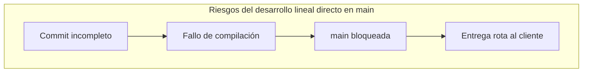

| Riesgo técnico | Qué sucede en el repositorio | Impacto en AzaharTech |
| :--- | :--- | :--- |
| **Código a medias publicado** | Se confirma una clase no terminada en `main`. | El proyecto no compila y la demo con el cliente falla. |
| **Pérdida de reversibilidad** | Se mezclan experimentos fallidos con código estable. | Revertir cambios obliga a deshacer commits manualmente. |
| **Colisiones de equipo** | Dos personas modifican el mismo archivo en `main`. | Conflictos de fusión imprevistos y bloqueos de entrega. |
| **Historial degradado** | Mensajes como *"guardo avance"* conviven con entregas. | Auditoría técnica confusa e inviable. |

##### ¿Qué es realmente una rama en Git?

Una rama **no duplica la carpeta ni los archivos del proyecto**. Es simplemente un **puntero móvil de 41 bytes** que referencia a un commit concreto. Cuando se realiza un nuevo commit en esa rama, el puntero avanza automáticamente. El puntero especial **`HEAD`** señala la rama y el commit en el que se encuentra situado el espacio de trabajo en cada instante.

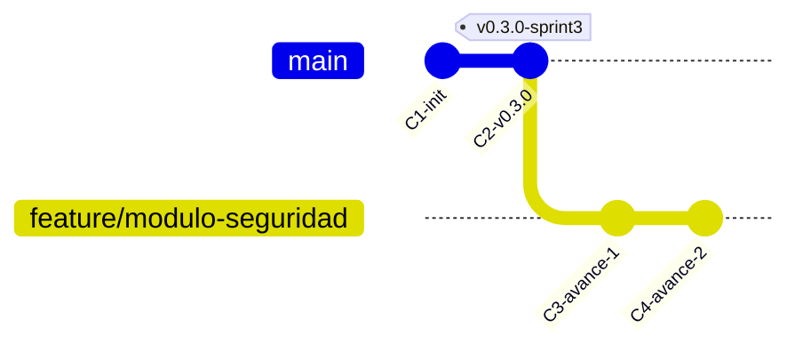

Mientras la rama `feature/modulo-seguridad` avanza acumulando trabajo, la rama `main` permanece inalterada en `C2`, garantizando que el software entregable siga compilando.

##### Nomenclatura corporativa de ramas

AzaharTech exige una convención predecible para identificar de inmediato el propósito de cada rama:

$$\text{Patrón obligatorio:} \quad \mathbf{feature/nombre-tarea}$$

| Regla | Formato correcto | Formato incorrecto | Justificación técnica |
| :--- | :--- | :--- | :--- |
| **Prefijo identificador** | `feature/modulo-seguridad` | `modulo-seguridad` | Distingue ramas temporales de la rama principal. |
| **Minúsculas estrictas** | `feature/clase-credencial` | `feature/ClaseCredencial` | Evita inconsistencias entre sistemas de archivos. |
| **Separación por guiones** | `feature/validar-dni` | `feature/validar dni`, `feature/validación` | Elimina caracteres especiales y espacios conflictivos. |
| **Orientada a la tarea** | `feature/ajuste-aforo` | `feature/lo-de-alba`, `feature/prueba2` | Describe el componente técnico, no a la persona. |

##### Ciclo de vida de una rama de desarrollo

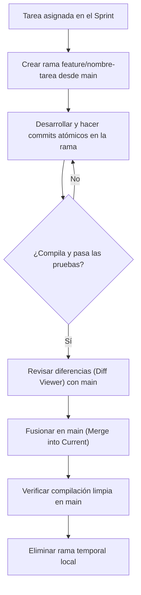

---

#### 3. Actividad activa interactiva: «¿En qué rama estoy?» en la pizarra

Alba y Pau proyectan un historial con dos ramas de desarrollo abiertas de forma simultánea. El grupo debe resolver las cuestiones planteadas antes de continuar:

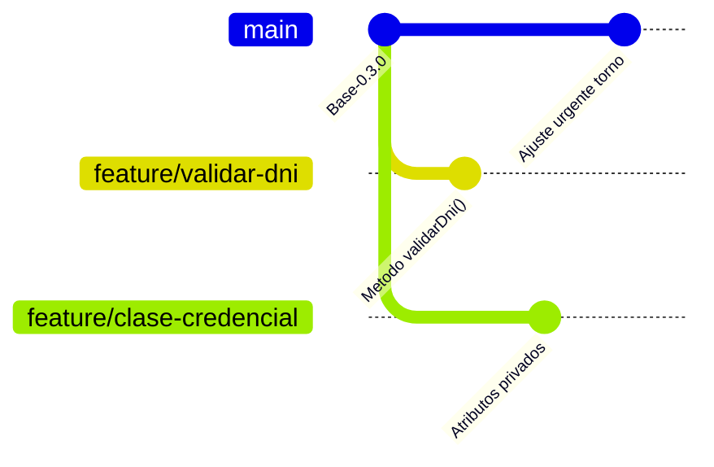

*Dinámica en parejas (10 minutos):*

1. **Lectura del grafo (3 min):**
    * ¿Cuántas ramas existen en el repositorio y cuál es el último commit de cada una?
    * ¿Se ha modificado `main` tras la creación de las ramas de características?
    * Si fusionáramos `feature/validar-dni` en `main`, ¿afectaría a los archivos de `feature/clase-credencial`? ¿Por qué?
2. **Propuesta de nomenclatura (3 min):** Definir el nombre corporativo correcto para tres tareas:

| Tarea técnica planteada | Nombre de rama propuesto |
| :--- | :--- |
| Implementar constructor con validación en `Usuario` | *(a completar por la pareja)* |
| Corregir el umbral de aforo máximo en el vestíbulo | *(a completar por la pareja)* |
| Probar un prototipo experimental de física de rebote | *(a completar por la pareja)* |

3. **Puesta en común (4 min):** Un estudiante voluntario señala en la pizarra en qué punto exacto se bifurcaría el puntero `HEAD` y dónde existiría riesgo de conflicto si dos ramas tocaran el mismo archivo.

---

#### Segunda sesión: dojo de herramientas y katas

> **Dinámica del dojo de entrenamiento:**
>
> * La **Kata 1 es obligatoria** para todo el grupo: enseña a crear ramas, aislar commits y verificar la estabilidad de `main` en IntelliJ IDEA.
> * Las **Katas 2 y 3 son optativas y de ampliación**: permiten profundizar en la inspección visual de diferencias (*Diff Viewer*) y en la integración rápida (*Fast-Forward*).
> 
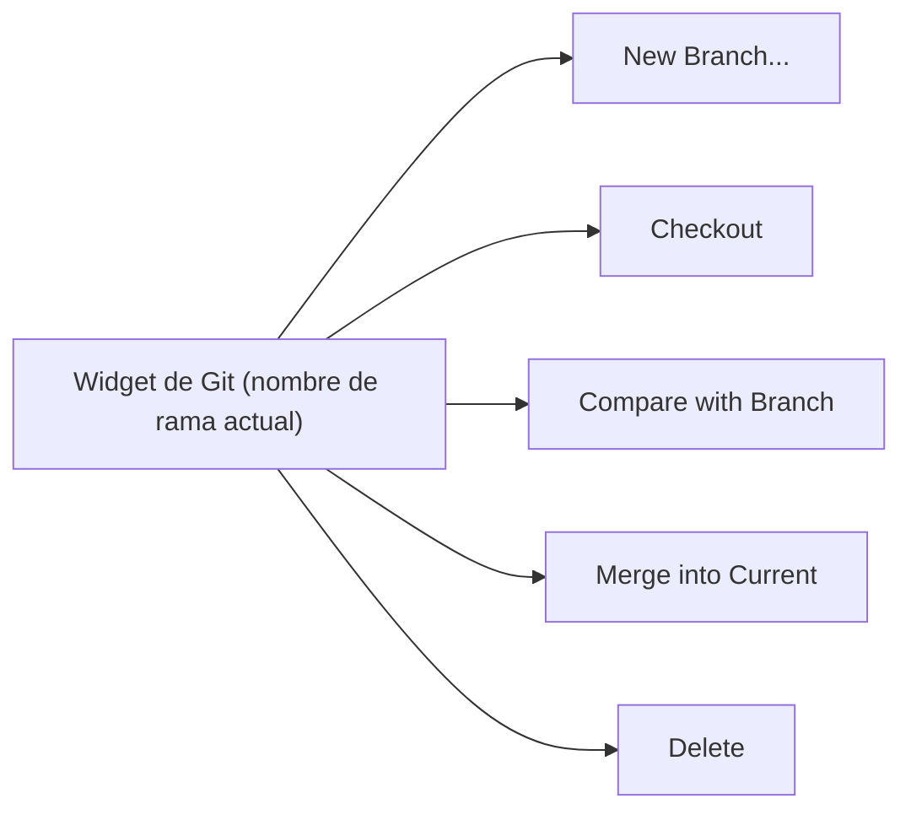

---

##### Kata 1. Obligatoria (cinturón blanco / nivel base). Rama `feature/modulo-seguridad`, commit visual y comprobación de aislamiento

* **Objetivo:** crear una rama personal desde `main` con la herramienta gráfica del IDE, aplicar un cambio aislado y comprobar en **Git Log** que la rama principal no se ha modificado.
* **Misión:**
    1. **Comprobar el punto de partida.** Abre el proyecto en IntelliJ IDEA y verifica en el widget de Git (esquina inferior izquierda) que estás ubicado en `main` y que la pestaña **Commit** (`Alt + 0`) no tiene cambios pendientes de confirmación.
    2. **Crear la rama.** Haz clic en el widget de Git ➔ **New Branch...** ➔ introduce el nombre `feature/modulo-seguridad` ➔ deja marcada la opción **Checkout branch** ➔ pulsa **Create**. Observa cómo el widget pasa a mostrar el nuevo nombre de rama.
    3. **Aplicar un cambio sencillo.** Con la rama activa, abre una clase o archivo de configuración de tu proyecto y añade un comentario Javadoc formal o una constante de configuración (por ejemplo, `public static final int NIVEL_SEGURIDAD = 1;`).
    4. **Commit visual.** Pulsa **`Ctrl + K`**, marca únicamente el archivo modificado, revisa el *Diff* haciendo doble clic sobre él y escribe el mensaje:  
       `feat(seguridad): primer avance del modulo de seguridad`  
       Pulsa el botón **Commit** (sin Push).
    5. **Verificación visual en Git Log.** Abre la pestaña inferior **Git** (`Alt + 9`) ➔ **Log**. Comprueba visualmente que:
        * La etiqueta `feature/modulo-seguridad` (junto al indicador amarillo `HEAD`) apunta al commit recién creado.
        * La etiqueta `main` se mantiene en el commit previo, **sin el cambio realizado**.
    6. **Prueba práctica de aislamiento.** Cambia a `main` desde el widget de Git (**main ➔ Checkout**). Comprueba que el archivo en el editor recupera su estado anterior y la constante desaparece. Vuelve a cambiar a tu rama (**feature/modulo-seguridad ➔ Checkout**) y confirma que el cambio reaparece intacto.

| Elemento verificado en Git Log | Estado esperado tras la Kata 1 |
| :--- | :--- |
| Etiqueta `feature/modulo-seguridad` (`HEAD`) | Apunta al commit nuevo recién realizado. |
| Etiqueta `main` | Permanece en el commit anterior, inalterada. |
| Contenido del archivo al hacer checkout a `main` | Vuelve a su estado original previo al cambio. |

---

##### Kata 2. Optativa (cinturón marrón / nivel avanzado). Inspección con *Compare with Branch* (Diff Viewer)

* **Contexto técnico:** antes de integrar una rama, el desarrollador debe revisar con exactitud qué líneas van a incorporarse a `main`.
* **Misión:**
    1. Estando en `feature/modulo-seguridad`, añade un segundo ajuste menor (por ejemplo, documentar la constante introducida) y realiza un nuevo commit:  
       `docs(seguridad): documentada constante de nivel de acceso`.
    2. Despliega el widget de Git, selecciona la rama `main` y haz clic en **Compare with Current**.
    3. En la ventana **Differences**, haz doble clic sobre el archivo modificado para abrir el visor comparativo (*Diff Viewer*).
    4. Interpreta los colores del visor:

| Color en el Diff Viewer | Significado técnico del cambio |
| :--- | :--- |
| **Verde** | Nuevas líneas agregadas en la rama de trabajo. |
| **Azul** | Líneas preexistentes que han sido modificadas. |
| **Gris** | Líneas eliminadas respecto a la rama comparada. |

---

##### Kata 3. Optativa (cinturón negro / «hacker AzaharTech»). Fusión Fast-Forward visual y borrado seguro

* **Contexto de arquitectura:** cuando una tarea en rama está terminada y validada, se fusiona en `main` y la rama temporal se elimina para mantener la higiene del repositorio.
* **Misión:**
    1. Cambia tu espacio de trabajo a la rama de destino: haz clic en el widget de Git ➔ **main ➔ Checkout**.
    2. Despliega de nuevo el widget de Git, haz clic sobre `feature/modulo-seguridad` y selecciona **Merge into Current**.
    3. Comprueba en **Git Log** que Git realiza un avance rápido (*Fast-Forward*): los punteros `main` y `feature/modulo-seguridad` señalan ahora al mismo commit.
    4. Verifica la compilación limpia del proyecto mediante el menú **Build ➔ Build Project**.
    5. Despliega el widget de Git, haz clic sobre `feature/modulo-seguridad` y selecciona **Delete**.
    6. Confirma que el commit permanece visible en el historial de `main` aunque la etiqueta de la rama haya desaparecido.

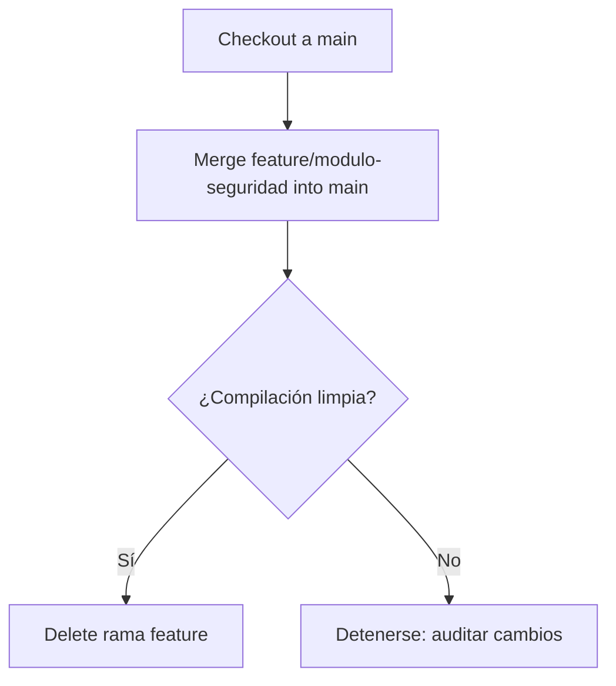

---

#### Entregables de la sesión

Al finalizar la sesión, el repositorio local debe mostrar el trabajo aislado en la rama correspondiente:

| Elemento afectado en el proyecto | Contenido técnico aportado | Operación gráfica en IntelliJ IDEA |
| :--- | :--- | :--- |
| Archivo de código o configuración de tu proyecto | Modificación aislada (comentario Javadoc o constante) realizada en la rama `feature/modulo-seguridad`. | Widget de Git ➔ **New Branch...** ➔ `Ctrl + K` ➔ **Commit**. Mensaje: `feat(seguridad): primer avance del modulo de seguridad`. |
| Estado del historial en Git Log | `feature/modulo-seguridad` contiene el nuevo commit mientras `main` permanece intacta (o fusionada si se completó la Kata 3). | Inspección visual en pestaña **Git ➔ Log** (`Alt + 9`). |

##### Pasos visuales paso a paso en IntelliJ IDEA:

1. **Verificar el contexto de trabajo.** Comprueba en el widget de Git (esquina inferior derecha) que estás en `feature/modulo-seguridad`.
2. **Abrir el panel de confirmación.** Pulsa **`Ctrl + K`** (o pestaña lateral **Commit** / `Alt + 0`).
3. **Auditoría visual previa.** Haz doble clic sobre el archivo modificado para abrir el *Diff Viewer* y revisar los cambios.
4. **Mensaje estructurado.** Marca la casilla del archivo e introduce el mensaje con Conventional Commits:  
   `feat(seguridad): primer avance del modulo de seguridad`
5. **Confirmar commit local.** Pulsa **Commit** (el cambio queda registrado exclusivamente en tu rama personal local).

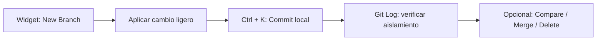

---

### Día 20 - 1 sesión

---

#### Sesión única. Taller práctico: dos ramas concurrentes, primer conflicto de fusión y resolución visual

---

#### 1. Caso guía en AzaharTech

Miércoles 18 de noviembre de 2026. Son las tres de la tarde en las oficinas de **AzaharTech**. Durante la jornada anterior, el equipo dominó la creación de ramas `feature/` y la verificación de aislamiento en `main`.

Al iniciar la sesión, **Laia Claramunt** proyecta una incidencia real registrada en el repositorio del **IES El Caminàs**:

> *«Ayer por la tarde, Alba y Pau trabajaron simultáneamente en dos ramas distintas para ajustar el archivo de configuración de seguridad. Alba cambió la directiva de acceso para indicar "Nivel: Restringido". Pau, en su propia rama, cambió esa misma línea por "Nivel: Solo personal docente". Cuando intentaron fusionar la segunda rama en `main`, Git se detuvo y mostró un aviso de* ***conflicto de fusión***.*
>
> *Un conflicto no es un error de programación ni un fallo del sistema. Aparece cuando dos ramas han modificado exactamente las mismas líneas de un archivo y Git no puede decidir de forma automática cuál debe prevalecer.*
>
> *Lo que distingue a un desarrollador profesional es no entrar en pánico: un conflicto en pausa no rompe nada en el disco. Hoy provocaremos un conflicto de forma controlada en nuestro proyecto y aprenderemos a resolverlo con el* ***asistente visual de tres paneles de IntelliJ IDEA***, *registrando la experiencia en el documento técnico oficial del sprint:* *`ed/docs/control-versiones.md`»*.

---

#### 2. Anatomía de un conflicto de fusión y el asistente visual

##### ¿Cuándo se produce un conflicto?

Git integra ramas automáticamente cuando los cambios afectan a archivos distintos o a líneas separadas del mismo fichero. El conflicto surge exclusivamente ante modificaciones incompatibles sobre la misma zona:

| Escenario de integración | ¿Provoca conflicto? | Motivo técnico |
| :--- | :---: | :--- |
| Rama A edita `Archivo1`, Rama B edita `Archivo2` | **No** | Cambios en ficheros independientes. |
| Rama A y Rama B editan líneas distintas del mismo archivo | **No** | Git combina ambos bloques automáticamente. |
| Rama A y Rama B editan **la misma línea de texto** | **Sí** | Ambigüedad: Git requiere criterio humano. |
| Rama A modifica un archivo y Rama B lo elimina | **Sí** | Incompatibilidad estructural directa. |

##### Representación gráfica del escenario del taller

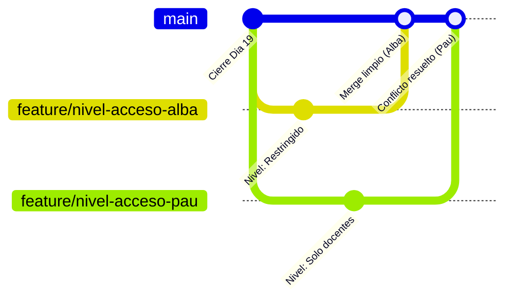

##### Flujo de resolución con el asistente visual

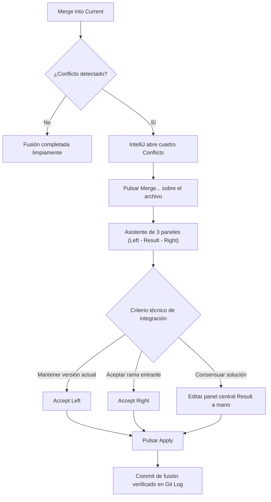

##### El asistente de resolución de tres paneles

Al pulsar el botón **Merge...** en la ventana de conflictos, IntelliJ IDEA abre su herramienta visual especializada:

| Panel visual | Denominación | Qué representa en la integración |
| :--- | :--- | :--- |
| **Columna izquierda** | *Left (Your Version)* | El estado actual de la rama en la que estás situado (`main`). |
| **Columna central** | *Result* | El resultado final editable que se consolidará en el proyecto. |
| **Columna derecha** | *Right (Their Version)* | El cambio que proviene de la rama que estás intentando fusionar. |

Mediante los botones `>>` y `<<` se incorporan cambios parciales al centro. Una vez que el panel central refleja la versión consensuada, se pulsa **Apply** para cerrar el conflicto limpiamente.

---

#### 3. Laboratorio práctico. Provocación y resolución de conflicto en tu proyecto

##### Fase 1. Estado inicial en `main`
Asegúrate de estar en `main` sin cambios pendientes. Abre una clase de configuración o un archivo de tu proyecto y define una variable o comentario base:
`// Nivel de acceso: PENDIENTE_CONFIGURAR`  
Haz commit en `main`: `chore(config): definida directiva base de acceso`.

##### Fase 2. Dos ramas desde el mismo commit
1. Widget de Git ➔ **New Branch...** ➔ `feature/nivel-acceso-alba` ➔ **Create**.
2. Modifica la línea por:  
   `// Nivel de acceso: RESTRINGIDO`
3. Haz commit (`Ctrl + K`): `feat(seguridad): configurado nivel restringido por alba`.
4. Vuelve a `main` desde el widget (**main ➔ Checkout**).
5. Widget de Git ➔ **New Branch...** ➔ `feature/nivel-acceso-pau` ➔ **Create**.
6. Modifica exactamente la misma línea por:  
   `// Nivel de acceso: SOLO_DOCENTES`
7. Haz commit (`Ctrl + K`): `feat(seguridad): configurado nivel docentes por pau`.

##### Fase 3. Primera fusión limpia y segunda fusión con conflicto
1. Haz checkout a **`main`**.
2. Fusiona la rama de Alba: widget de Git ➔ `feature/nivel-acceso-alba` ➔ **Merge into Current**. La fusión se aplica sin problemas (*Fast-Forward*).
3. Intenta fusionar la rama de Pau: widget de Git ➔ `feature/nivel-acceso-pau` ➔ **Merge into Current**.
4. IntelliJ interrumpe el proceso y muestra la ventana emergente **Conflicts**.

##### Fase 4. Resolución visual en el asistente
1. En el diálogo de conflictos, haz clic sobre el archivo afectado y pulsa **Merge...**
2. Se abrirá la vista de tres columnas (*Left*, *Result*, *Right*).
3. En el panel central (*Result*), redacta la solución consensuada por el equipo:  
   `// Nivel de acceso: RESTRINGIDO_PERSONAL_DOCENTE`
4. Pulsa el botón **Apply**. El conflicto queda resuelto sin marcas residuales (`<<<<<<<`, `=======`, `>>>>>>>`).
5. IntelliJ formaliza el *Merge Commit* automáticamente.

##### Fase 5. Limpieza de ramas locales
1. Widget de Git ➔ `feature/nivel-acceso-alba` ➔ **Delete**.
2. Widget de Git ➔ `feature/nivel-acceso-pau` ➔ **Delete**.
3. Abre **Git ➔ Log** (`Alt + 9`) y comprueba el commit de fusión con dos líneas convergentes.

---

#### Entregables de la sesión

Al finalizar la sesión, debes crear el documento técnico oficial del sprint en la ruta estándar del módulo: **`ed/docs/control-versiones.md`**, completando los Apartados 1 y 2:

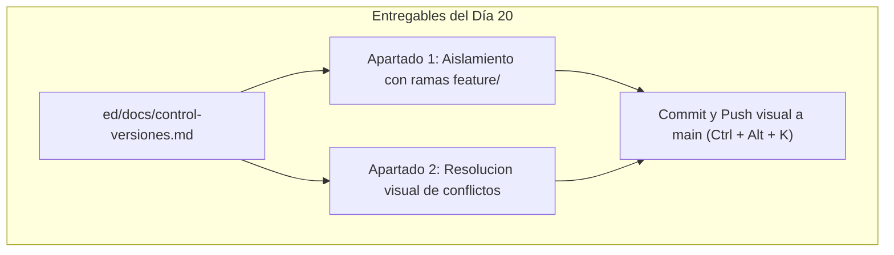

| Archivo en el repositorio | Apartados a cumplimentar | Operación gráfica en IntelliJ IDEA |
| :--- | :--- | :--- |
| **`ed/docs/control-versiones.md`** | **Apartado 1.** Justificación del aislamiento con ramas.<br>**Apartado 2.** Registro del conflicto provocado y resolución visual aplicada. | `Ctrl + K` ➔ redacción de mensaje ➔ desplegar flecha ➔ **Commit and Push...** (`Ctrl + Alt + K`). |

##### Plantilla obligatoria a incorporar en `ed/docs/control-versiones.md`:

```markdown
# Memoria Técnica - Sprint 4: Control de versiones individual y documentación técnica

## Apartado 1: Aislamiento funcional con ramas locales (`feature/`)

### 1. Justificación técnica del principio de aislamiento
El desarrollo directo sobre la rama `main` compromete la estabilidad del proyecto entregable.
El uso de ramas de características (`feature/`) permite aislar cambios en progreso, asegurando
que la rama principal siempre compile limpiamente y esté disponible para el cliente.

### 2. Ciclo de vida y nomenclatura aplicada
- **Patrón corporativo:** `feature/nombre-tarea` (minúsculas y guiones).
- **Ramas utilizadas en la sesión:** `feature/modulo-seguridad`, `feature/nivel-acceso-alba`, `feature/nivel-acceso-pau`.

---

## Apartado 2: Gestión y resolución visual de conflictos de fusión

### 1. Origen del conflicto provocado
- **Archivo afectado:** `[Ruta del archivo modificado, ej. src/main/java/.../Config.java]`
- **Rama A (Alba):** Modificó la línea con el valor `RESTRINGIDO`.
- **Rama B (Pau):** Modificó exactamente la misma línea con el valor `SOLO_DOCENTES`.

### 2. Proceso de resolución con el asistente visual
- **Herramienta empleada:** Asistente de fusión de 3 paneles (*Merge Tool*) de IntelliJ IDEA.
- **Decisión técnica adoptada:** Consensuar la integración combinando ambos requisitos.
- **Resultado consolidado en el panel Result:** `RESTRINGIDO_PERSONAL_DOCENTE`.
- **Verificación posterior:** Fusión cerrada sin marcas textuales de conflicto y compilación verificada.

### 3. Diagrama del historial consolidado (Mermaid)

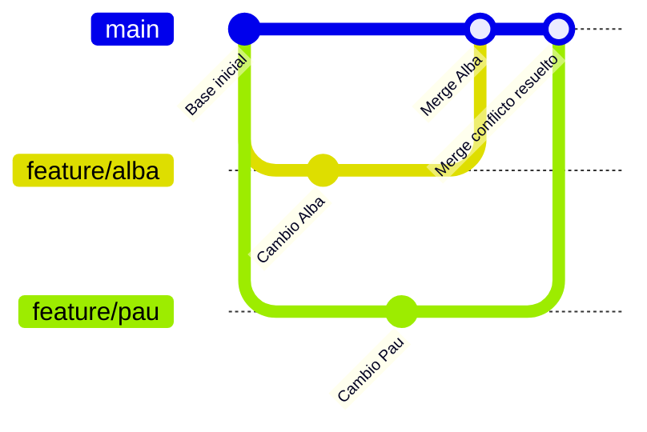

##### Pasos visuales para el commit y push en IntelliJ IDEA:

1. Verifica en el widget de Git que estás situado en **`main`**.
2. Pulsa **`Ctrl + K`** (o pestaña lateral **Commit**).
3. Marca la casilla del nuevo archivo `ed/docs/control-versiones.md`.
4. Escribe el mensaje formal estructurado:  
   `docs(git): creado control-versiones.md con apartados 1 y 2 de ramas y conflictos`
5. Despliega la flecha del botón azul y selecciona **Commit and Push...** (`Ctrl + Alt + K`).
6. En el cuadro de diálogo *Push Commits*, confirma que el destino remoto es `origin/main` y pulsa el botón azul **Push**.

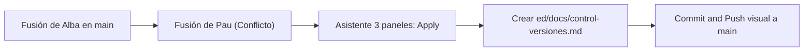

## Semana 11. Documentación técnica: Javadoc y Markdown

---

### Día 21 - 2 sesiones

---

#### Primera sesión. Teoría. El código que se explica solo: Javadoc y documentación de API

---

#### 1. Caso guía en AzaharTech

Lunes 23 de noviembre de 2026. Son las tres de la tarde en la sede de **AzaharTech** en Castellón de la Plana. Tras haber superado la semana anterior la resolución visual de conflictos, el equipo encara la segunda semana del **Sprint 4**.

Al abrir la jornada técnica, **Laia Claramunt** proyecta un correo urgente remitido por el coordinador de infraestructuras del **IES El Caminàs**:

> *«Equipo, el instituto ha incorporado hoy a un técnico informático para mantener el módulo de accesos. Al revisar la clase `Credencial` que programasteis, se ha encontrado con métodos sin documentar: no sabe qué rango de valores admite el constructor, qué formato devuelve `permiteAcceso()` ni por qué el atributo `nivelAcceso` es privado. Ha perdido dos horas deduciéndolo leyendo el código línea a línea.*
>
> *Esa pérdida de tiempo es el síntoma inequívoco de un proyecto con **deuda técnica documental**. En Programación ya estáis creando clases propias con constructores, atributos y métodos `public` y `private`. Cada línea de código que escribáis hoy será leída mañana por otra persona, o por vosotros mismos dentro de tres meses.*
>
> *Hoy aprenderemos a documentar con **Javadoc**, el estándar oficial de Java, y a generar la documentación técnica navegable desde IntelliJ IDEA. Y lo haremos aplicando el flujo profesional que aprendisteis la semana pasada: trabajando en una rama aislada, **`feature/documentacion-javadoc`**, sin tocar jamás directamente la rama `main`»*.

**Alba Torres** pregunta con curiosidad: *«¿Y no bastaría con poner comentarios de una línea con `//`?»*. **Pau Ferrer** niega con la cabeza: *«Un comentario `//` solo lo lee quien abre el archivo y se pone a bucear en su código fuente. Un bloque Javadoc lo interpreta el propio IDE, lo muestra al pasar el ratón por encima del método y es capaz de compilar un sitio web interactivo para el cliente»*.

---

#### 2. Tres niveles de documentación y anatomía de un bloque Javadoc

En el desarrollo de software industrial coexisten tres niveles documentales complementarios:

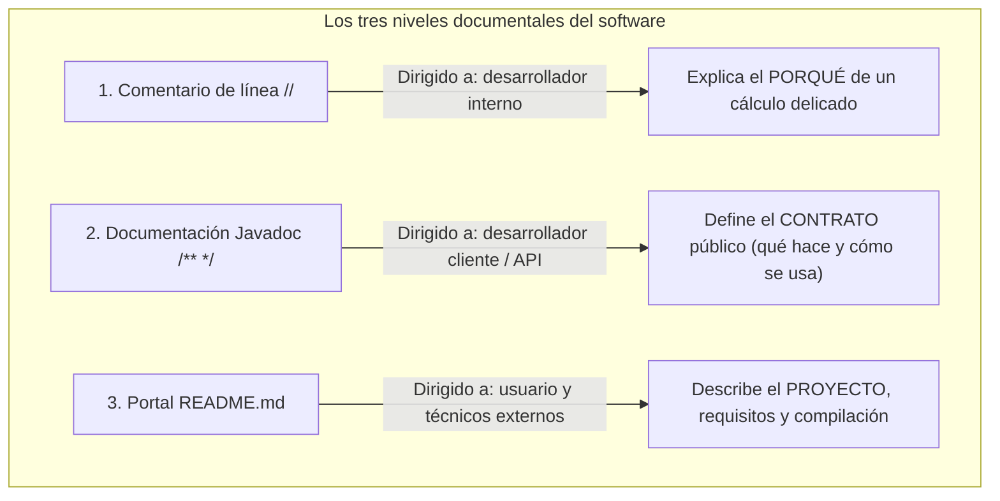

| Nivel documental | Herramienta | A quien va dirigido | Ubicación física | Propósito técnico |
| :--- | :--- | :--- | :--- | :--- |
| **Comentario de línea** | `// texto` | Desarrollador que modifica el interior del método. | En el cuerpo del algoritmo. | Justificar una optimización o un algoritmo complejo. |
| **Documentación de API** | Javadoc `/** ... */` | Desarrollador que consume la clase desde fuera. | Antes de clases, constructores y métodos. | Definir el contrato de uso sin mostrar el código fuente. |
| **Documentación de proyecto** | Markdown (`README.md`) | Quien clona o evalúa el repositorio por primera vez. | En la raíz del proyecto. | Explicar arquitectura, requisitos y comandos de construcción. |

##### Anatomía y etiquetas esenciales de Javadoc

Un bloque Javadoc se coloca inmediatamente encima de la cabecera de la clase o método que documenta, iniciándose con `/**` y empleando etiquetas normalizadas que comienzan por `@`:

```java
/**
 * Representa la credencial de acceso para los usuarios del IES El Caminàs.
 *
 * @author Alba Torres (AzaharTech)
 * @version 1.0.0
 */
public class Credencial {

    private final String dni;
    private int nivelAcceso;

    /**
     * Construye una credencial validando los datos obligatorios de entrada.
     *
     * @param dni Documento de identidad del usuario; no puede ser nulo ni vacío.
     * @param nivelAcceso Nivel asignado entre 1 (restringido) y 3 (total).
     * @throws IllegalArgumentException Si el DNI está vacío o el nivel fuera de rango.
     */
    public Credencial(String dni, int nivelAcceso) {
        if (dni == null || dni.isBlank() || nivelAcceso < 1 || nivelAcceso > 3) {
            throw new IllegalArgumentException("Datos de credencial no válidos.");
        }
        this.dni = dni;
        this.nivelAcceso = nivelAcceso;
    }

    /**
     * Evalúa si la credencial autoriza la apertura de un torno con un nivel dado.
     *
     * @param nivelTorno Nivel mínimo de seguridad exigido por el torno.
     * @return {@code true} si el nivel de la credencial es igual o superior; {@code false} en caso contrario.
     */
    public boolean permiteAcceso(int nivelTorno) {
        return this.nivelAcceso >= nivelTorno;
    }
}
```

##### Criterios de calidad: qué documentar y qué omitir

| Elemento Java | ¿Requiere Javadoc? | Criterio técnico corporativo |
| :--- | :---: | :--- |
| **Clase `public`** | **Obligatorio** | Describe el propósito de la entidad en el dominio del negocio. |
| **Constructores y métodos `public`** | **Obligatorio** | Forman el contrato de uso para el resto del equipo. |
| **Métodos y atributos `private`** | **Opcional** | Son detalles internos de implementación; basta un comentario `//` si son complejos. |
| **Getters / Setters triviales** | **Mínimo** | Evitar redundancias obvias (por ejemplo: `getNombre()` no necesita tres párrafos; una línea basta). |

---

#### 3. El ciclo de vida de la documentación en ramas de Git

En AzaharTech la documentación no se añade de forma desordenada en producción. Se aísla en su propia rama de característica:

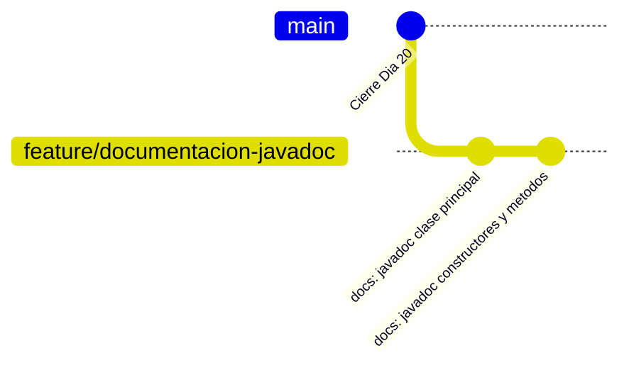

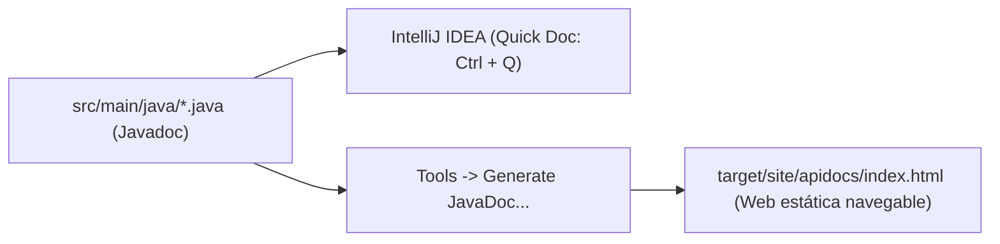

---

#### 4. Actividad activa interactiva: «Detective de documentación» en la pizarra

Alba y Pau proyectan un extracto de código con Javadoc defectuoso extraído de un commit de prueba:

```java
/**
 * Comprueba el acceso.
 *
 * @param nivel el nivel
 */
public boolean permiteAcceso(int nivelTorno) {
    return this.nivelAcceso >= nivelTorno;
}
```

*Dinámica en parejas (10 minutos):*

1. **Caza de defectos (4 min).** Cada pareja detecta y anota los tres errores del bloque:
    * El nombre de `@param nivel` no coincide con el identificador real del parámetro (`nivelTorno`).
    * Falta la etiqueta obligatoria `@return`.
    * La descripción «Comprueba el acceso» no explica el criterio de evaluación ni las condiciones booleanas de salida.
2. **Reescritura técnica (4 min).** Cada pareja redacta la versión corregida definiendo precondiciones y el significado de los valores devueltos.
3. **Puesta en común (2 min).** Un voluntario escribe la solución en la pizarra y el grupo comprueba que, al pasar el ratón en IntelliJ (o pulsar **`Ctrl + Q`**), el IDE interpreta el formato sin advertencias.

---

#### Segunda sesión: dojo de herramientas y katas

> **Dinámica del dojo de entrenamiento:**
>
> * La **Kata 1 es obligatoria**: crea la rama `feature/documentacion-javadoc`, documenta formalmente una clase de tu proyecto y verifica la ayuda contextual en el IDE.
> * Las **Katas 2 y 3 son optativas y de ampliación**: permiten compilar la documentación web completa y depurar advertencias mediante las inspecciones automáticas de IntelliJ IDEA.

---

##### Kata 1. Obligatoria (cinturón blanco / nivel base). Documentación formal en la rama `feature/documentacion-javadoc`

* **Objetivo:** crear una rama de desarrollo, documentar con sintaxis Javadoc una clase propia de tu proyecto y verificar su visualización en IntelliJ IDEA mediante *Quick Documentation*.
* **Misión:**
    1. Comprueba en el widget de Git (esquina inferior derecha) que estás ubicado en **`main`** y sin cambios pendientes.
    2. Haz clic en el widget de Git ➔ **New Branch...** ➔ introduce el nombre `feature/documentacion-javadoc` ➔ pulsa **Create**.
    3. Abre la clase principal de tu proyecto (o la clase de dominio que estás programando en Programación).
    4. En la línea superior a la clase, escribe `/**` y pulsa **Intro**: IntelliJ generará automáticamente el esqueleto con `@author` y `@version`.
    5. Repite la operación encima del constructor y de al menos dos métodos públicos: completa las etiquetas `@param`, `@return` y `@throws` detallando rangos y condiciones.
    6. **Verificación interactiva:** Pasa el ratón sobre una llamada al método o sitúa el cursor en él y pulsa **`Ctrl + Q`** (en Windows/Linux) o **`F1`** (en macOS). Verifica que la ventana flotante renderiza el texto formateado con sus parámetros.
    7. **Commit visual:** Pulsa **`Ctrl + K`**, marca el archivo de la clase y confirma localmente con el mensaje:  
       `docs(javadoc): documentada la api publica de la clase principal`.

---

##### Kata 2. Optativa (cinturón marrón / nivel avanzado). Generación del portal HTML con *Generate JavaDoc...*

* **Contexto técnico:** el Javadoc se compila como un sitio web estático navegable que se entrega al cliente como documentación viva de la API.
* **Misión:**
    1. Ve al menú superior **Tools ➔ Generate JavaDoc...**
    2. En *Scope*, selecciona **Current File** o tu paquete principal.
    3. En *Output directory*, selecciona la ruta estándar de construcción: `target/site/apidocs`.
    4. En el selector de visibilidad, marca **Public** (para que solo documente la API accesible y no los detalles privados).
    5. Pulsa **Generate**.
    6. Una vez completado, localiza el archivo `target/site/apidocs/index.html` en el árbol de archivos, haz clic derecho ➔ **Open in ➔ Browser**.
    7. Navega por las páginas generadas y audita que tu clase y sus métodos aparecen con descripciones nítidas.

---

##### Kata 3. Optativa (cinturón negro / «hacker AzaharTech»). Auditoría automática con inspecciones de código

* **Contexto de arquitectura:** en equipos profesionales, nadie revisa etiquetas a mano; IntelliJ IDEA incluye un motor de inspección estática que detecta discrepancias documentales en tiempo real.
* **Misión:**
    1. Introduce deliberadamente un error de prueba en tu clase: cambia el nombre de una etiqueta `@param` para que no coincida con el argumento real del método. Observa el subrayado amarillo de advertencia.
    2. Ve al menú **Code ➔ Inspect Code...** ➔ selecciona **Whole project** ➔ pulsa **Analyze**.
    3. En la ventana inferior de resultados, despliega la sección **Java ➔ Javadoc**.
    4. Haz clic en cada aviso y pulsa **`Alt + Intro`** para aplicar las soluciones rápidas automáticas sugeridas por el IDE.
    5. Vuelve a ejecutar la inspección hasta obtener **0 avisos de Javadoc** en tus clases.
    6. Haz un commit local en tu rama: `docs(javadoc): subsanadas advertencias de la inspeccion estatica`.

---

#### Entregables de la sesión

Al finalizar el taller, el repositorio debe reflejar el trabajo aislado en la rama de documentación:

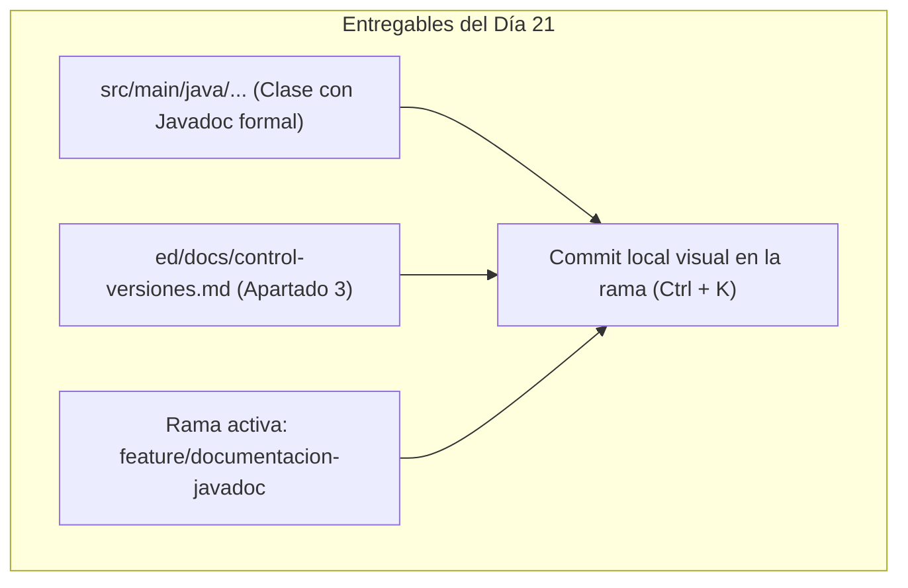

| Elemento en el proyecto | Contenido técnico aportado | Operación gráfica en IntelliJ IDEA |
| :--- | :--- | :--- |
| **Clase Java documentada** | Cabecera de clase, constructor y al menos dos métodos `public` documentados con `@param`, `@return` y `@throws`. | Edición asistida con `/**` + Intro ➔ verificación con `Ctrl + Q`. |
| **`ed/docs/control-versiones.md`** | **Apartado 3.** Registro de etiquetas utilizadas, clase documentada y verificación con *Quick Documentation*. | Edición de Markdown ➔ `Ctrl + K` ➔ **Commit** local en la rama `feature/documentacion-javadoc`. |
| **Historial en Git Log** | La rama `feature/documentacion-javadoc` contiene los nuevos commits, mientras `main` permanece intacta. | Comprobación visual en pestaña **Git ➔ Log** (`Alt + 9`). |

##### Plantilla obligatoria a incorporar en `ed/docs/control-versiones.md`:

```markdown
## Apartado 3: Documentación técnica del código con Javadoc

### 1. Clase documentada y contexto de trabajo
- **Clase auditada:** `[Nombre de la clase Java de tu proyecto]`
- **Rama de trabajo activa:** `feature/documentacion-javadoc`

### 2. Elementos documentados y etiquetas aplicadas
| Elemento Java | Visibilidad | Etiquetas Javadoc empleadas | Propósito técnico |
| :--- | :--- | :--- | :--- |
| Clase | `public` | `@author`, `@version` | Identificación del módulo y versión semántica. |
| Constructor | `public` | `@param`, `@throws` | Validación de parámetros de entrada obligatorios. |
| Método `[nombre1]` | `public` | `@param`, `@return` | Contrato de cálculo o verificación de estado. |
| Método `[nombre2]` | `public` | `@param`, `@return`, `@throws` | Lógica de negocio con control de excepciones. |

### 3. Verificación de calidad en el entorno
- **Visualización contextual (Ctrl + Q):** [Confirmar que la ventana Quick Documentation renderiza el formato correctamente].
- **Inspección de código (Code Inspect):** [Indicar si se superó con 0 advertencias o qué discrepancias se corrigieron].
```

##### Pasos visuales paso a paso en IntelliJ IDEA:

1. **Verificar rama activa.** Confirma en el widget de Git inferior que estás en `feature/documentacion-javadoc` y **no** en `main`.
2. **Abrir ventana de confirmación.** Pulsa **`Ctrl + K`** (o pestaña lateral izquierda **Commit**).
3. **Auditoría visual (Diff Viewer).** Haz doble clic sobre los archivos modificados para verificar que solo se han añadido comentarios Javadoc y el Apartado 3 de la memoria.
4. **Mensaje formal.** Introduce el mensaje estructurado con Conventional Commits:  
   `docs(javadoc): documentada la api publica de la clase principal`
5. **Confirmar commit local.** Haz clic en el botón azul **Commit** (sin Push; la integración en `main` se completará en la siguiente sesión).

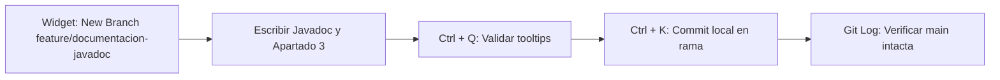

---

### Día 22 - 1 sesión

---

#### Sesión única. Taller práctico: README corporativo, integración múltiple de ramas y verificación en `main`

---

#### 1. Caso guía en AzaharTech

Miércoles 25 de noviembre de 2026. Son las tres de la tarde en las oficinas de **AzaharTech**.

Laia Claramunt y Pau Ferrer proyectan en pantalla la vista web del repositorio del **IES El Caminàs** en GitHub. La portada muestra únicamente un archivo `README.md` desactualizado desde el Sprint 2:

> *«Mirad la pantalla principal de nuestro repositorio. Si un evaluador externo o el coordinador del centro clona el proyecto, se encuentra con carpetas de código pero sin ninguna explicación de qué resuelve el sistema, qué requisitos técnicos exige o cómo se compila.*
>
> *El archivo **`README.md` es la puerta de entrada y la tarjeta de presentación** de cualquier desarrollo profesional. Hoy completaremos una práctica de integración real de ingeniería:*
> 1. *Redactaremos un `README.md` profesional en una rama independiente:* *`feature/readme`.*
> 2. *Haremos checkout a `main` e integraremos de forma secuencial **ambas ramas** (la de Javadoc del lunes y la del README de hoy).*
> 3. *Verificaremos que `main` compila limpiamente de extremo a extremo sin advertencias.*
> 4. *Registraremos el hito documental mediante el Apartado 4 en nuestro documento oficial:* *`ed/docs/control-versiones.md`»* [10].

---

#### 2. La puerta de entrada al repositorio y la integración secuencial

##### Estructura mínima de un `README.md` corporativo en AzaharTech

Un `README.md` profesional debe resolver de forma inmediata las necesidades de instalación y uso de cualquier técnico:

| Sección obligatoria | Pregunta técnica que responde | Contenido esperado |
| :--- | :--- | :--- |
| **Título y descripción** | ¿Qué es este sistema y a quién sirve? | Nombre oficial, descripción ejecutiva del reto y vinculación con el cliente. |
| **Requisitos de entorno** | ¿Qué herramientas necesito para ejecutarlo? | Versión del JDK (OpenJDK 21 LTS) y versión mínima de Maven (3.9+). |
| **Estructura del proyecto** | ¿Dónde reside cada elemento de la solución? | Diagrama de directorios respetando la convención Maven (`src/`, `ed/docs/`). |
| **Compilación y ejecución** | ¿Cómo se construye el software sin depender del IDE? | Comandos Maven estándar (`mvn clean compile`, `mvn javadoc:javadoc`). |
| **Estado y trazabilidad** | ¿En qué hito del desarrollo nos encontramos? | Indicación del Sprint 4 en curso y estado de verificación. |

##### El plan de integración de múltiples ramas

Durante esta sesión consolidaremos dos líneas de desarrollo concurrentes hacia la rama principal:

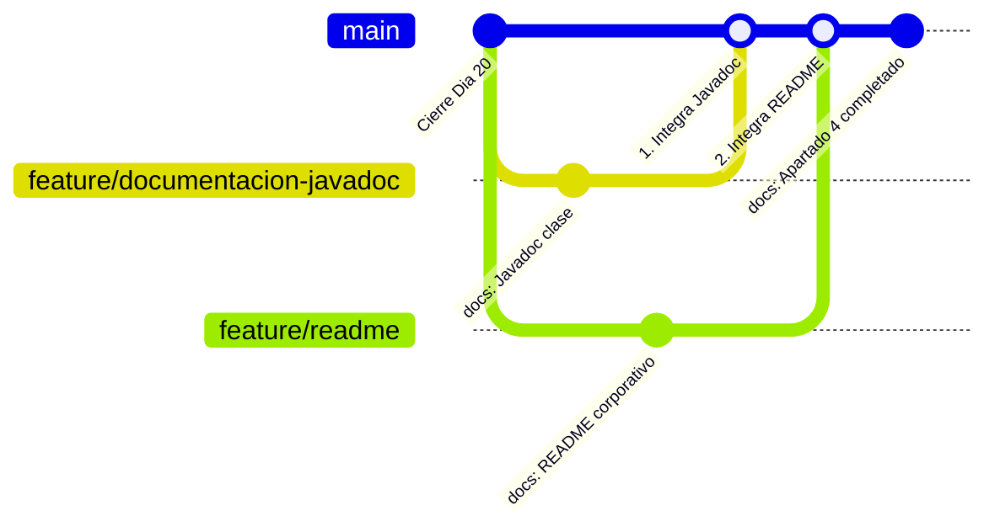

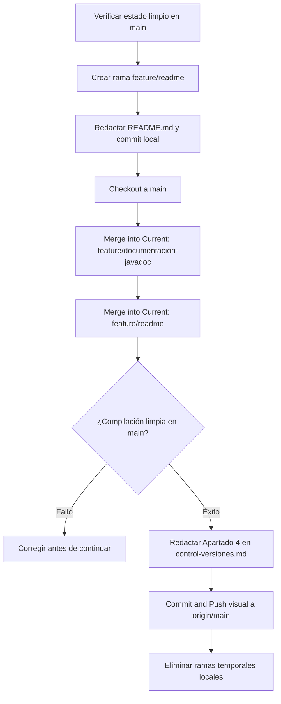

---

#### 3. Laboratorio práctico: Construcción en rama y fusión doble en `main`

> **Dinámica de laboratorio:**
>
> * La actividad se ejecuta individualmente en el repositorio personal siguiendo el protocolo de cuatro fases.
> * Las ramas tocan archivos distintos (`src/` y la raíz), por lo que la integración se aplicará de forma limpia sin colisiones de texto.

##### Fase 1. Redacción del README en la rama `feature/readme`
1. Comprueba en el widget de Git que estás en `main`.
2. Widget de Git ➔ **New Branch...** ➔ `feature/readme` ➔ **Create**.
3. Abre el archivo `README.md` situado en la raíz de tu proyecto (o créalo si no existiera mediante clic derecho en la raíz ➔ **New ➔ File ➔ README.md**).
4. Activa la vista dividida (*Split Editor*) en IntelliJ IDEA para previsualizar el formato mientras escribes.
5. Completa la estructura técnica adaptándola a tu proyecto de la bolsa:

```markdown
# [Nombre del Proyecto] — AzaharTech

> Incremento de software correspondiente al **Sprint 4 (Semana 11)**.  
> Módulo desarrollado para el cliente **IES El Caminàs**.

---

## 1. Descripción del proyecto
[Breve descripción de 3 o 4 líneas resumiendo el problema que resuelve la aplicación y sus características principales].

## 2. Requisitos de entorno
- **Java Development Kit:** OpenJDK 21 LTS.
- **Herramienta de construcción:** Apache Maven 3.9+.
- **Entorno de desarrollo:** IntelliJ IDEA Community / Ultimate 2026.2+.

## 3. Estructura del repositorio
```text
azahartech/tu-equipo/tus-apellidos-nombre/
├── README.md                          <-- Portal técnico de aterrizaje
├── pom.xml                            <-- Descriptor Maven y dependencias
├── .gitignore                         <-- Exclusión de target/ y temporales
├── ed/
│   └── docs/
│       ├── marco-scrum.md             <-- Documentación Sprint 1
│       ├── viaje-codigo.md            <-- Documentación Sprint 2
│       ├── ciclo-error.md             <-- Documentación Sprint 3
│       └── control-versiones.md       <-- Documentación Sprint 4
└── src/
    └── main/
        └── java/                      <-- Código fuente con Javadoc formal


## 4. Compilación y generación técnica
Para construir y verificar el software de forma automatizada mediante Maven:


# Limpiar binarios y compilar el código fuente
mvn clean compile

# Generar el portal web estático de Javadoc
mvn javadoc:javadoc


## 5. Realiza el commit en la rama: pulsa **`Ctrl + K`**, marca `README.md` y confirma con el mensaje:  
   `docs(readme): anadido portal tecnico corporativo del proyecto`.
```
  
##### Fase 2. Fusión secuencial de ambas ramas en `main`
1. Cambia tu espacio de trabajo a la rama principal: widget de Git ➔ **main ➔ Checkout**.
2. **Primera integración (Javadoc).** Widget de Git ➔ haz clic en `feature/documentacion-javadoc` ➔ selecciona **Merge into Current**.
3. **Segunda integración (README).** Widget de Git ➔ haz clic en `feature/readme` ➔ selecciona **Merge into Current**.
4. Al afectar a archivos diferentes, IntelliJ completa ambas integraciones sin conflictos.

##### Fase 3. Verificación de compilación y limpieza
1. Comprueba que el proyecto compila íntegramente en `main`: menú superior **Build ➔ Build Project** (o ejecuta la fase `compile` desde la ventana lateral de Maven).
2. Elimina las ramas locales que ya han sido integradas:
   * Widget de Git ➔ `feature/documentacion-javadoc` ➔ **Delete**.
   * Widget de Git ➔ `feature/readme` ➔ **Delete**.
3. Abre **Git ➔ Log** (`Alt + 9`) y confirma que el historial de `main` muestra la incorporación limpia de ambas líneas de trabajo.

---

#### Entregables de la sesión

Al finalizar la sesión, la rama `main` del repositorio debe contener el `README.md` corporativo, el código documentado con Javadoc y el **Apartado 4** formalizado en `ed/docs/control-versiones.md`:

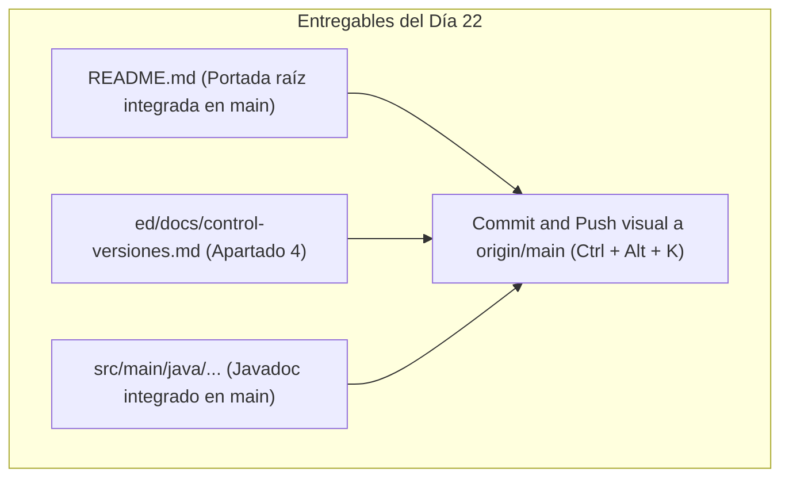

| Elemento en el proyecto | Apartado o contenido | Operación gráfica en IntelliJ IDEA |
| :--- | :--- | :--- |
| **`README.md` (raíz)** | Descripción, requisitos, estructura Maven y comandos de compilación. | Creado en `feature/readme` y fusionado en `main`. |
| **`ed/docs/control-versiones.md`** | **Apartado 4:** Registro de la integración secuencial de ramas y verificación de compilación. | `Ctrl + K` ➔ redacción de mensaje ➔ **Commit and Push...** (`Ctrl + Alt + K`). |
| **Estado de ramas locales** | Ramas `feature/` temporales eliminadas tras la fusión; `main` limpia y sincronizada con GitHub. | Widget de Git ➔ **Delete** de ramas temporales. |

##### Plantilla a incorporar en `ed/docs/control-versiones.md`:

```markdown
## Apartado 4: Integración secuencial de ramas y documentación externa

### 1. Registro de ramas integradas en `main`
| Rama de trabajo | Contenido incorporado | Tipo de fusión aplicado | Resultado en el IDE |
| :--- | :--- | :--- | :--- |
| `feature/documentacion-javadoc` | Javadoc de la clase principal | Fast-Forward / Merge commit | Integración limpia sin conflictos. |
| `feature/readme` | README.md corporativo en raíz | Merge commit automático | Integración limpia sin colisiones. |

### 2. Estructura aplicada en el README.md corporativo
- **Información de contexto:** Identificación del reto de software y cliente asignado.
- **Requisitos de infraestructura:** Especificación del JDK 21 LTS y Apache Maven 3.9+.
- **Arquitectura de directorios:** Mapa de carpetas respetando el estándar del proyecto.
- **Instrucciones de compilación:** Guía de construcción automatizada mediante Maven.

### 3. Verificación de compilación en `main`
- **Resultado de compilación:** Confirmada satisfactoriamente mediante *Build Project* / Maven compile.
- **Higiene del repositorio:** Ramas temporales eliminadas localmente tras la fusión.
```

##### Pasos visuales paso a paso para el commit y push en IntelliJ IDEA:

1. Asegúrate de estar situado en la rama **`main`** (comprueba el widget inferior).
2. Pulsa **`Ctrl + K`** (o pestaña lateral **Commit**).
3. Marca la casilla de verificación de `ed/docs/control-versiones.md`.
4. Escribe el mensaje formal estructurado con Conventional Commits:  
   `docs(git): anadido apartado 4 y completada integracion secuencial de documentacion`
5. Haz clic en la flecha del botón azul y selecciona **Commit and Push...** (`Ctrl + Alt + K`).
6. En la ventana emergente *Push Commits*, comprueba que el destino es `origin/main` y haz clic en el botón azul **Push**.

```mermaid
flowchart LR
    S1["feature/readme: Commit"] --> S2["Checkout main"]
    S2 --> S3["Merge Javadoc + Merge README"]
    S3 --> S4["Build Project: Verificado"]
    S4 --> S5["Redactar Apartado 4 en control-versiones.md"]
    S5 --> S6["Commit and Push visual a origin/main"]
    S6 --> S7["Delete ramas temporales"]
```

## Semana 12. Versionado semántico, higiene y release

---

### Día 23 - 2 sesiones

---

#### Primera sesión. Teoría. Ponerle número a lo que entregas: versionado semántico, higiene del repositorio y etiquetas de release

---

#### 1. Caso guía en AzaharTech

Lunes 30 de noviembre de 2026. Son las tres de la tarde en la sede de **AzaharTech** en Castellón de la Plana. Arranca la tercera y última semana del **Sprint 4**.

**Laia Claramunt** proyecta en la pantalla de la sala de reuniones el repositorio del cliente y señala tres problemas técnicos antes de dar paso al correo del coordinador del **IES El Caminàs**:

> *«Equipo, el viernes cerramos el Sprint 4 y el instituto necesita una entrega congelada que pueda almacenar, citar y, en caso de fallo, restaurar de inmediato en el torno de conserjería. Ahora mismo nuestro repositorio arrastra tres deficiencias graves:*
>
> *1. Nadie sabe con certeza qué versión está instalada: el descriptor `pom.xml` sigue indicando `0.3.0-SNAPSHOT` desde octubre.*
> *2. En algunos equipos la carpeta `target/` con los binarios `.class` compilados y metadatos del IDE (`.idea/`, `*.iml`) siguen apareciendo como pendientes en Git, ensuciando el historial.*
> *3. Cuando la dirección del centro nos pregunta qué novedades incorpora el sistema respecto al mes pasado, la única respuesta disponible es obligarles a leer una lista dispersa de cuarenta commits.*
>
> *Una entrega profesional de ingeniería exige un número de versión matemático, un repositorio 100% higiénico y un registro de cambios legible para seres humanos. Esta semana resolveremos las tres cuestiones y, siguiendo nuestra disciplina metodológica, lo haremos desde una rama aislada:* *`feature/preparar-release`*, *sin tocar jamás `main` directamente»*.

**Alba Torres** pregunta con curiosidad: *«¿Y la versión no puede ser simplemente un número correlativo como 1, 2, 3 o 4?»*. **Pau Ferrer** niega con la cabeza: *«Si solo sumas números al azar, no le comunicas nada al cliente. Con el versionado semántico, un simple vistazo al número le indica si puede actualizar con total tranquilidad o si la actualización romperá la compatibilidad de su sistema»*.

---

#### 2. Versionado semántico (*SemVer*) y su relación con los Conventional Commits

El estándar internacional **SemVer (Semantic Versioning 2.0.0)** establece que toda versión de software se estructura mediante tres números enteros separados por puntos:

$$\mathbf{MAJOR.MINOR.PATCH}$$

```mermaid
flowchart LR
    V["v0.4.0"] --> MA["MAJOR = 0"]
    V --> MI["MINOR = 4"]
    V --> PA["PATCH = 0"]
    MA --> MA2["Fase inicial de desarrollo (API provisional)"]
    MI --> MI2["Nueva funcionalidad compatible (Clases de dominio + Javadoc)"]
    PA --> PA2["Corrección de fallos compatible (Bugfixes)"]
```

| Componente | Cuándo se incrementa | Impacto en quien consume el software | Ejemplo práctico en el IES El Caminàs |
| :--- | :--- | :--- | :--- |
| **`MAJOR` (Mayor)** | Cambios incompatibles en la API pública (*breaking changes*). | Quien consume la clase debe adaptar o reescribir su código. | `1.0.0` ➔ `2.0.0`: `permiteAcceso(int)` pasa a exigir un objeto complejo `Torno`. |
| **`MINOR` (Menor)** | Nuevas funcionalidades que mantienen la compatibilidad previa. | El cliente puede incorporar lo nuevo sin que lo anterior falle. | `0.3.0` ➔ `0.4.0`: nuevas clases de dominio (`Credencial`) y Javadoc de API. |
| **`PATCH` (Parche)** | Corrección de defectos (*bugs*) sin añadir nuevas funciones. | Riesgo cero de actualización: el software es más robusto. | `0.4.0` ➔ `0.4.1`: corregido el límite de temperatura del sensor en el torno. |

##### Reglas de versionado en AzaharTech

* **La serie `0.y.z`.** Indica que el producto se encuentra en fase de construcción inicial (nuestro MVP del primer trimestre). La API aún evoluciona hasta consolidar la futura `1.0.0`.
* **El sufijo `-SNAPSHOT` en Maven.** Indica una versión *en construcción activa*, inestable y sujeta a cambios diarios. **Una versión de release oficial jamás lleva `-SNAPSHOT` en su descriptor.**
* **Inmutabilidad.** Una vez publicada una versión con su etiqueta Git, el código asociado no se modifica jamás. Si se detecta un error, se incrementa el parche (`0.4.1`) en una nueva entrega.

##### Conexión directa: de los Conventional Commits al incremento SemVer

Los prefijos estandarizados en los mensajes de confirmación permiten deducir mecánicamente la versión de release:

| Prefijo del commit | Tipo de cambio aportado | Incremento SemVer asociado |
| :--- | :--- | :---: |
| `fix:` | Corrección de un defecto o bug | **`PATCH`** |
| `feat:` | Incorporación de nueva funcionalidad compatible | **`MINOR`** |
| `feat!:` o pie `BREAKING CHANGE:` | Modificación que rompe compatibilidad previa | **`MAJOR`** |
| `docs:`, `refactor:`, `test:`, `chore:` | Mantenimiento interno sin impacto en el comportamiento | Sin salto de versión (se agrupan) |

---

#### 3. Higiene técnica del repositorio: qué se versiona y qué se ignora

La máxima directriz de un desarrollador profesional es clara: **en Git solo se versiona aquello que no se puede regenerar automáticamente**.

```mermaid
flowchart TD
    A["Archivo nuevo en el espacio de trabajo"] --> B{"¿Se puede reconstruir con mvn clean compile?"}
    B -- Sí --> C["NUNCA se versiona: va a .gitignore (target/)"]
    B -- No --> D{"¿Es configuración privada del IDE o del sistema operativo?"}
    D -- Sí --> C
    D -- No --> E["Se versiona: código fuente src/, pom.xml, docs/"]
```

| Elemento en el proyecto | ¿Se versiona en Git? | Motivo técnico de ingeniería |
| :--- | :---: | :--- |
| `src/`, `pom.xml`, `README.md`, `ed/docs/` | **SÍ** | Constituyen el código fuente original y la memoria técnica del software. |
| `target/` | **NO** | Contiene binarios regenerables; versionarlos provoca colisiones y satura el repositorio. |
| `.idea/`, `*.iml` | **NO** | Metadatos locales del IDE de cada programador; incompatibles entre diferentes máquinas. |
| `.DS_Store`, `Thumbs.db` | **NO** | Residuos temporales de índices del explorador del sistema operativo. |
| Contraseñas o credenciales | **NUNCA** | Una vez confirmadas en Git, se consideran comprometidas de por vida. |

> **Aviso de auditoría.** El archivo `.gitignore` solo surte efecto sobre archivos que **no hayan sido rastreados previamente**. Si la carpeta `target/` se confirmó por descuido en el Sprint 1 o 2, Git seguirá vigilándola hasta que se elimine expresamente del índice del repositorio.

##### Contenido corporativo del archivo `.gitignore`

```text
# Directorio de construcción y binarios generados por Maven
target/

# Metadatos del entorno de desarrollo (IntelliJ IDEA)
.idea/
*.iml
out/

# Residuos del sistema operativo y logs
.DS_Store
Thumbs.db
*.log
*.tmp
```

---

#### 4. Etiquetas de versión (*Git Tags*) y el registro de cambios (*CHANGELOG.md*)

Mientras que una **rama** es un puntero móvil que avanza con cada nueva instrucción confirmada, una **etiqueta (*Tag*)** es un ancla fija e inmutable colocada sobre un commit exacto:

```mermaid
gitGraph
   commit id: "Cierre Sprint 3" tag: "v0.3.0-sprint3"
   commit id: "feat: modelo Credencial"
   commit id: "docs: Javadoc API"
   commit id: "docs: README corporativo"
   commit id: "chore: version 0.4.0" tag: "v0.4.0-sprint4"
```

| Tipo de etiqueta | Contenido que registra | Ámbito de uso en AzaharTech |
| :--- | :--- | :--- |
| **Etiqueta ligera (*Lightweight*)** | Puntero simple al identificador del commit. | Marcas personales efímeras de depuración. |
| **Etiqueta anotada (*Annotated*)** | Puntero, autor, fecha, firma y mensaje descriptivo formal. | **Obligatoria para todas las releases oficiales de sprint.** |

##### El archivo `CHANGELOG.md`

El `CHANGELOG.md` es el documento de cara al cliente que recopila de manera ordenada y legible qué ha cambiado entre versiones, evitando que el usuario deba interpretar los mensajes internos de los commits:

```markdown
# Registro de Cambios (Changelog)

Todos los cambios notables de este proyecto se documentan en este archivo.
El formato se basa en [Keep a Changelog](https://keepachangelog.com/es-ES/1.1.0/).

## [0.4.0] - 2026-12-02
### Añadido
- Clase `Credencial` con validación de nivel de acceso y atributos privados.
- Documentación técnica interna de la API pública mediante bloques Javadoc.
- Portal corporativo `README.md` con requisitos de entorno y comandos de construcción.

### Modificado
- Descriptor `pom.xml` actualizado a la versión estable `0.4.0` (eliminado sufijo `-SNAPSHOT`).

### Corregido
- Resuelto defecto en la validación de límites térmicos del torno de acceso.
```

---

#### 5. Actividad activa interactiva: «¿Qué número le toca?» en la pizarra

Alba y Pau proyectan el historial reciente de commits desde la versión `v0.3.2` para resolver en la pizarra:

| Secuencia de commits recientes | Mensaje descriptivo del commit |
| :---: | :--- |
| Commit 1 | `fix(torno): corregido error de redondeo en el calculo de minutos` |
| Commit 2 | `docs(readme): anadidos requisitos minimos de memoria RAM` |
| Commit 3 | `feat(acceso): incorporada lectura de codigo de barras secundario` |
| Commit 4 | `refactor(core): reorganizada visibilidad de variables auxiliares` |

*Dinámica en parejas (10 minutos):*

1. **Decisión conjunta (4 min).** Cada pareja anota en su libreta qué versión SemVer corresponde publicar y la justifica técnicamente.  
   *Solución:* **`0.4.0`**, porque el cambio de mayor peso es un `feat` compatible hacia atrás (`MINOR`), lo que reinicia el dígito `PATCH` a `0`.
2. **Giro imprevisto (3 min).** Laia añade un nuevo commit:  
   *`feat!(api): eliminada la compatibilidad con el formato antiguo de DNI sin letra`*.  
   ¿Qué número corresponde ahora?  
   *Solución:* Rompe el contrato previo (`BREAKING CHANGE`), por lo que exige un salto de `MAJOR` (hacia `1.0.0` o `0.5.0` en fase provisional).
3. **Puesta en común (3 min).** Un estudiante voluntario transcribe en la pizarra qué secciones del `CHANGELOG.md` se alimentarían con estos cambios y descarta las que no interesan al cliente (por ejemplo, el `refactor` interno).

---

#### Segunda sesión: dojo de herramientas y katas

> **Dinámica del dojo de entrenamiento:**
>
> * La **Kata 1 es obligatoria**: aislar la preparación de la release en la rama `feature/preparar-release`, sanear el archivo `.gitignore`, actualizar la versión en el `pom.xml` y redactar el `CHANGELOG.md`.
> * Las **Katas 2 y 3 son optativas y de ampliación**: permiten dominar la creación visual de etiquetas anotadas y su sincronización remota con GitHub.

---

##### Kata 1. Obligatoria (cinturón blanco / nivel base). Repositorio higiénico, versión `0.4.0` y `CHANGELOG.md` en rama aislada

* **Objetivo:** crear una rama de desarrollo dedicada a la release, eliminar del seguimiento de Git cualquier binario no deseado, fijar la versión oficial sin `-SNAPSHOT` en Maven y formalizar el registro de cambios.
* **Misión:**
    1. Comprueba en el widget de Git de IntelliJ IDEA (esquina inferior derecha) que estás en la rama **`main`** y que la pestaña **Commit** (`Alt + 0`) no tiene cambios pendientes.
    2. Haz clic en el widget de Git ➔ **New Branch...** ➔ introduce el nombre:  
       `feature/preparar-release` ➔ pulsa **Create**.
    3. **Auditoría de higiene (.gitignore):** Abre o crea el archivo `.gitignore` en la raíz de tu proyecto. Asegúrate de que contiene las exclusiones de `target/`, `.idea/`, `*.iml`, `.DS_Store` y residuos temporales.
    4. Comprueba en el explorador de proyectos que la carpeta `target/` se visualiza en color **naranja oscuro o gris atenuado** (*ignored*). Si apareciera en blanco o azul (rastreada por error en commits antiguos), elimínala del índice mediante clic derecho sobre `target/` ➔ **Git ➔ Remove from VCS** (conservando los archivos locales).
    5. **Fijar versión de release en Maven:** Abre el archivo `pom.xml` y actualiza la etiqueta de versión sustituyendo `0.3.0-SNAPSHOT` (o la que tuvieras) por la versión estable oficial:  
       `<version>0.4.0</version>`  
       Pulsa el icono flotante de recarga de Maven (**Load Maven Changes** o `Ctrl + Shift + O`).
    6. **Registro de cambios:** Crea en la raíz de tu proyecto el archivo `CHANGELOG.md` y completa la entrada `[0.4.0]` documentando las novedades de las clases y del Javadoc según el trabajo real de tu proyecto.
    7. **Commit visual en la rama:** Pulsa **`Ctrl + K`**, marca exclusivamente `.gitignore`, `pom.xml` y `CHANGELOG.md`, y confirma localmente con el mensaje:  
       `chore(release): preparada version 0.4.0 y repositorio saneado`.
    8. Abre **Git ➔ Log** (`Alt + 9`) y verifica que `main` permanece intacta y que el commit reside únicamente en tu rama de trabajo.

---

##### Kata 2. Optativa (cinturón marrón / nivel avanzado). Creación visual de la etiqueta anotada `v0.4.0-sprint4`

* **Contexto técnico:** una etiqueta anotada sella formalmente el commit, vinculando autoría, fecha y resumen técnico inmutable.
* **Misión:**
    1. En la pestaña **Git ➔ Log** (`Alt + 9`), haz clic derecho sobre el commit `chore(release): preparada version 0.4.0...` recién creado.
    2. Selecciona la opción **New Tag...**
    3. En el campo *Tag Name*, introduce: `v0.4.0-sprint4`.
    4. En el campo *Message*, redacta el resumen formal:  
       `Release oficial Sprint 4: Clases de dominio, aislamiento con ramas y documentacion Javadoc`.
    5. Pulsa **Create Tag**.
    6. Comprueba que el grafo de commits de IntelliJ dibuja la insignia de etiqueta amarilla junto al commit.

---

##### Kata 3. Optativa (cinturón negro / «hacker AzaharTech»). Publicación remota con *Push Tags* y auditoría web

* **Contexto de arquitectura:** las etiquetas no viajan a GitHub mediante un Push ordinario; requieren una instrucción de sincronización explícita.
* **Misión:**
    1. Haz checkout a `main` desde el widget de Git e integra la rama mediante **`feature/preparar-release` ➔ Merge into Current** (practicando el flujo previo a la sesión de consolidación del Día 24).
    2. Abre la ventana de subida mediante **Git ➔ Push...** (`Ctrl + Shift + K`).
    3. En la esquina inferior izquierda del diálogo, despliega la opción **Push Tags** y marca **All** (o la etiqueta recién creada).
    4. Pulsa el botón azul **Push**.
    5. Abre tu repositorio en el navegador web y entra en el apartado **Tags** (o *Releases*). Verifica que la etiqueta `v0.4.0-sprint4` figura publicada con sus metadatos y mensaje intactos.

---

#### Entregables de la sesión

Al finalizar el dojo, el repositorio local debe mostrar la preparación de la versión en la rama correspondiente:

```mermaid
flowchart TD
    subgraph Entregable["Entregables del Día 23"]
        E1[".gitignore saneado (raíz)"]
        E2["pom.xml con versión 0.4.0 oficial"]
        E3["CHANGELOG.md con entrada 0.4.0 (raíz)"]
        E4["Rama activa: feature/preparar-release"]
        E5["Commit visual local (Ctrl + K)"]
    end
    E1 --> E5
    E2 --> E5
    E3 --> E5
    E4 --> E5
```

| Elemento técnico | Contenido aportado | Operación gráfica en IntelliJ IDEA |
| :--- | :--- | :--- |
| **`.gitignore`** | Exclusión estricta de `target/`, `.idea/`, `*.iml` y residuos temporales. | Menú contextual ➔ **New ➔ File** ➔ comprobación en panel Commit. |
| **`pom.xml`** | Versión semántica fijada en `0.4.0` (sin `-SNAPSHOT`). | Edición de etiqueta `<version>` ➔ **Load Maven Changes** (`Ctrl + Shift + O`). |
| **`CHANGELOG.md`** | Registro ordenado de cambios para la versión `[0.4.0]` (*Añadido*, *Modificado*, *Corregido*). | Creación de archivo en raíz ➔ previsualización en Markdown Split View. |
| **Historial en Git Log** | Commit formal de release aislado en `feature/preparar-release`, con `main` inalterada. | Comprobación visual en pestaña **Git ➔ Log** (`Alt + 9`). |

##### Pasos visuales paso a paso en IntelliJ IDEA:

1. **Verificar rama de trabajo:** Comprueba en el widget de Git (esquina inferior derecha) que estás situado en `feature/preparar-release` y **no** en `main`.
2. **Abrir panel de confirmación:** Pulsa **`Ctrl + K`** (o pestaña lateral **Commit** / `Alt + 0`).
3. **Auditoría visual de diferencias:** Haz doble clic sobre cada archivo para revisar el *Diff Viewer* y verificar que no hay archivos de `target/` marcados por error.
4. **Mensaje formal estructurado:** Introduce el mensaje con Conventional Commits:  
   `chore(release): preparada version 0.4.0 y repositorio saneado`
5. **Confirmar commit local:** Haz clic en el botón azul **Commit** (sin Push; la integración en `main` y la publicación de la release se formalizarán en el Día 24).

```mermaid
flowchart LR
    S1["Widget: New Branch feature/preparar-release"] --> S2[".gitignore + pom.xml 0.4.0 + CHANGELOG.md"]
    S2 --> S3["Ctrl + K: Commit local en rama"]
    S3 --> S4["Git Log: Verificar main intacta"]
    S4 --> S5["Opcional: Kata 2 New Tag v0.4.0-sprint4"]
```

---

### Día 24 - 1 sesión

---

#### Sesión única. Taller práctico: integración en `main`, empaquetado del artefacto `.jar`, GitHub Releases y cierre del Sprint 4

---

#### 1. Caso guía en AzaharTech

Miércoles 2 de diciembre de 2026. Son las tres de la tarde en las oficinas de **AzaharTech**. Faltan cuarenta y ocho horas para cerrar formalmente el **Sprint 4** antes del periodo de consolidación y exámenes del trimestre.

Laia Claramunt y Pau Ferrer proyectan la sección de **Releases** de un proyecto de código abierto de referencia en GitHub, llamando la atención del equipo sobre sus elementos visibles: un número de versión matemático, un registro de cambios estructurado y un **archivo binario ejecutable descargable**:

> *«Equipo, así es como se entrega software en el mundo real. Un cliente de consultoría no descarga código fuente para compilarlo con Maven ni inspecciona ramas de Git: **descarga una release empaquetada y lista para funcionar**.*
>
> *Hoy completaremos el ciclo de vida de entrega de AzaharTech de principio a fin:*
> 1. *Fusionaremos la rama `feature/preparar-release` en `main`.*
> 2. *Construiremos el artefacto ejecutable distribuible (`.jar`) mediante el ciclo de vida de Maven.*
> 3. *Crearemos la etiqueta anotada oficial **`v0.4.0-sprint4`** y la publicaremos en GitHub.*
> 4. *Publicaremos la **GitHub Release** en la web adjuntando el binario `.jar` para el cliente.*
> 5. *Cerraremos el sprint cumplimentando los Apartados 5 y 6 en nuestro documento oficial:* *`ed/docs/control-versiones.md`»*.

---

#### 2. El flujo integral de una release profesional

```mermaid
gitGraph
   commit id: "Cierre Dia 22"
   branch "feature/preparar-release"
   checkout "feature/preparar-release"
   commit id: ".gitignore + CHANGELOG"
   commit id: "chore: version 0.4.0"
   checkout main
   merge "feature/preparar-release" id: "1. Integracion release"
   commit id: "2. Build verificado" tag: "v0.4.0-sprint4"
```

```mermaid
flowchart TD
    A["Verificar estado limpio en main"] --> B["Merge into Current: feature/preparar-release"]
    B --> C["Maven Lifecycle: clean package"]
    C --> D{"¿BUILD SUCCESS y target/*.jar?"}
    D -- Fallo --> E["Detenerse: subsanar en rama temporal"]
    D -- Éxito --> F["Crear Tag anotado v0.4.0-sprint4"]
    F --> G["Push a GitHub con Push Tags activado"]
    G --> H["Crear Release en GitHub y adjuntar el archivo .jar"]
    H --> I["Redactar Apartados 5 y 6 en control-versiones.md"]
    I --> J["Eliminar rama feature/preparar-release"]
```

##### Lista de control previa a la publicación de la release

| Verificación técnica | Dónde se comprueba | Criterio de aceptación estricto |
| :--- | :--- | :--- |
| **Rama activa** | Widget de Git | Situado en `main`, sin archivos pendientes ni ramas sucias. |
| **Versión estable** | Archivo `pom.xml` | `<version>0.4.0</version>` (sin sufijo `-SNAPSHOT`). |
| **Construcción limpia** | Pestaña **Maven ➔ Lifecycle ➔ package** | Mensaje `BUILD SUCCESS` y archivo `.jar` generado en `target/`. |
| **Registro de cambios** | Archivo `CHANGELOG.md` | Sección `[0.4.0]` completa con novedades y correcciones. |
| **Higiene del repositorio** | Panel **Commit** (`Alt + 0`) | Carpeta `target/` y metadatos `.idea/` totalmente excluidos. |
| **Etiqueta anotada** | Pestaña **Git ➔ Log** (`Alt + 9`) | Tag `v0.4.0-sprint4` fijado en el commit final de `main`. |

---

#### 3. Laboratorio práctico: de la rama de trabajo al artefacto distribuido

##### Fase 1. Fusión de la release en `main`
1. Cambia tu espacio de trabajo a la rama principal: widget de Git ➔ **main ➔ Checkout**.
2. Despliega el widget de Git, haz clic sobre `feature/preparar-release` y selecciona **Merge into Current**.
3. Abre **Git ➔ Log** (`Alt + 9`) y comprueba que `main` ha avanzado incorporando el saneamiento y el `CHANGELOG.md`.

##### Fase 2. Empaquetado del artefacto ejecutable con Maven
1. Abre la ventana lateral derecha **Maven** (icono con la «m» azul).
2. Despliega la carpeta **Lifecycle**.
3. Haz doble clic en la fase **clean** y, a continuación, doble clic en la fase **package**.
4. Comprueba en la consola inferior de ejecución el mensaje final:  
   `[INFO] BUILD SUCCESS`.
5. Abre el explorador del proyecto y despliega la carpeta `target/`: comprueba que existe el archivo empaquetado:  
   `target/<artifactId>-0.4.0.jar`.

##### Fase 3. Etiquetado y publicación de la GitHub Release
1. **Etiquetado.** En **Git ➔ Log**, haz clic derecho sobre el último commit de `main` ➔ **New Tag...** ➔ introduce el nombre `v0.4.0-sprint4` y el mensaje formal de release. Pulsa **Create Tag**.
2. **Sincronización remota.** Pulsa **`Ctrl + Shift + K`** (*Push*), activa la casilla **Push Tags** en la esquina inferior izquierda y haz clic en el botón azul **Push**.
3. **Publicación de la Release en la web:**
    * Abre tu repositorio en el navegador web en GitHub.
    * En el menú lateral derecho, haz clic en **Releases ➔ Draft a new release**.
    * En el desplegable *Choose a tag*, selecciona **`v0.4.0-sprint4`**.
    * En *Release title*, escribe: `Release v0.4.0 - Sprint 4 (AzaharTech)`.
    * En la caja de descripción, pega el texto correspondiente a la entrada `[0.4.0]` de tu `CHANGELOG.md`.
    * **Adjuntar el binario:** Arrastra el archivo `.jar` generado en tu carpeta local `target/` al recuadro de archivos adjuntos (*Attach binaries by dropping them here*).
    * Pulsa el botón verde **Publish release**.

> **Regla de oro de AzaharTech:**  
> El archivo `.jar` se adjunta directamente a la Release en la interfaz web de GitHub; **jamás se versiona ni se sube con un commit a Git**. Por ese motivo la carpeta `target/` permanece ignorada en el `.gitignore`.

##### Fase 4. Limpieza de ramas locales
1. En IntelliJ IDEA, despliega el widget de Git, haz clic sobre `feature/preparar-release` y selecciona **Delete**.
2. Confirma en **Git ➔ Log** que `main` y `origin/main` apuntan al mismo commit y que la etiqueta es visible en ambos.

---

#### 4. Dinámica de cierre: auditoría cruzada por parejas

Los estudiantes intercambian sus puestos de trabajo en parejas. Cada compañero adopta el rol de **técnico de infraestructuras del IES El Caminàs** y debe auditar la entrega **exclusivamente desde la página web de GitHub, sin abrir IntelliJ**:

```mermaid
flowchart LR
    Auditor["Compañero (Técnico del IES)"] --> A1["1. Abrir GitHub Releases"]
    A1 --> A2["2. Descargar archivo .jar"]
    A2 --> A3["3. Leer Changelog de la versión"]
    A3 --> A4["4. Comprobar que target/ no está en el código"]
    A4 --> A5["5. Firmar Acta de Cierre en control-versiones.md"]
```

| Criterio técnico auditado en GitHub | Estado verificado | Observación técnica |
| :--- | :---: | :--- |
| **Versión sin `-SNAPSHOT`** | [ ] Conforme | La versión es `0.4.0` limpia en el `pom.xml`. |
| **Binario `.jar` descargable** | [ ] Conforme | El ejecutable está adjunto en la Release web. |
| **`CHANGELOG.md` estructurado** | [ ] Conforme | Describe qué hay de nuevo sin abrir el código fuente. |
| **Higiene de `.gitignore`** | [ ] Conforme | La carpeta `target/` y archivos `.class` no existen en GitHub. |
| **Etiqueta anotada publicada** | [ ] Conforme | El tag `v0.4.0-sprint4` está publicado y visible. |

---

#### Entregables de la sesión

Al finalizar la sesión, el repositorio remoto debe tener la release publicada con su `.jar`, las ramas temporales eliminadas y el documento oficial **`ed/docs/control-versiones.md`** completado con los **Apartados 5 y 6**:

```mermaid
flowchart TD
    subgraph Entregable["Entregables del Día 24 (Cierre Sprint 4)"]
        R1["main integrada y limpia en origin/main"]
        R2["Tag anotado v0.4.0-sprint4 publicado"]
        R3["GitHub Release publicada con el archivo .jar adjunto"]
        R4["ed/docs/control-versiones.md (Apartados 5 y 6)"]
        R5["Commit and Push visual a main (Ctrl + Alt + K)"]
    end
    R1 --> R5
    R2 --> R5
    R3 --> R5
    R4 --> R5
```

| Elemento técnico | Contenido aportado | Operación gráfica en IntelliJ IDEA |
| :--- | :--- | :--- |
| **Rama `main`** | Integración limpia de la release y artefacto `.jar` empaquetado. | Widget de Git ➔ **Merge into Current**; panel Maven ➔ **package**. |
| **GitHub Release** | Título, descripción del `CHANGELOG.md` y archivo `.jar` adjunto. | Interfaz web de GitHub ➔ **Releases ➔ Publish release**. |
| **`ed/docs/control-versiones.md`** | **Apartado 5:** Justificación SemVer y release.<br>**Apartado 6:** Acta técnica de cierre del Sprint 4. | `Ctrl + K` ➔ redacción de mensaje ➔ **Commit and Push...** (`Ctrl + Alt + K`). |

##### Plantilla a incorporar en `ed/docs/control-versiones.md`:

```markdown
## Apartado 5: Versionado semántico, higiene y release

### 1. Decisión técnica de versión
| Parámetro | Valor asignado | Justificación técnica |
| :--- | :--- | :--- |
| **Versión oficial publicada** | `0.4.0` | Cierre del Sprint 4: incorporación de clases de dominio y Javadoc de API pública. |
| **Identificador SemVer** | Incremento `MINOR` | Ampliación funcional manteniendo compatibilidad hacia atrás. |
| **Etiqueta de Git** | `v0.4.0-sprint4` | Tag anotado con autoría, fecha y mensaje formal de entrega. |

### 2. Informe de higiene técnica del repositorio
| Elemento verificado | Estado de exclusión | Criterio de aseguramiento de calidad |
| :--- | :---: | :--- |
| Directorio `target/` | Conforme | Verificado que ningún binario `.class` está versionado en Git. |
| Configuración local `.idea/` y `*.iml` | Conforme | Parámetros específicos del entorno personal ignorados. |
| Limpieza de ramas temporales | Conforme | Rama `feature/preparar-release` eliminada tras su fusión. |

### 3. Publicación del artefacto distribuible
- **Artefacto empaquetado:** `target/[nombre-proyecto]-0.4.0.jar` mediante `mvn clean package`.
- **Publicación en GitHub Releases:** Release oficial creada asociando la etiqueta `v0.4.0-sprint4` con el archivo `.jar` adjunto como binario descargable.

---

## Apartado 6: Acta de cierre técnico del Sprint 4

| Hito técnico del Sprint 4 | Criterio de evaluación | Estado verificado |
| :--- | :--- | :---: |
| **Aislamiento en ramas** | Uso sistemático de ramas `feature/` para nuevas tareas | Conforme (Git Log) |
| **Resolución de conflictos** | Uso del asistente visual de 3 paneles en IntelliJ IDEA | Conforme (Apartado 2) |
| **Documentación de API** | Javadoc formal con `@param`, `@return` y `@throws` | Conforme (Apartado 3) |
| **Documentación externa** | `README.md` corporativo y `CHANGELOG.md` en raíz | Conforme (Apartado 4) |
| **Release oficial** | Tag anotado `v0.4.0-sprint4` y binario publicado en GitHub | Conforme (Apartado 5) |

- **Desarrollador responsable:** [Nombre del Alumno]
- **Auditor técnico asignado:** [Nombre del Compañero]
- **Dictamen técnico final:** APTO para evaluación trimestral del Sprint 4.
- **Aprendizaje clave del sprint:** [Una frase de síntesis técnica propia].
```

##### Pasos visuales paso a paso para el commit y push final en IntelliJ IDEA:

1. Asegúrate de estar situado en la rama **`main`** (comprueba el widget de Git).
2. Pulsa **`Ctrl + K`** (o pestaña lateral **Commit**).
3. Marca la casilla de `ed/docs/control-versiones.md`.
4. Cerciórate en el panel de cambios de que ningún archivo dentro de `target/` ni `.idea/` aparece pendiente de confirmación.
5. Redacta el mensaje formal estructurado con Conventional Commits:  
   `docs(release): anadidos apartados 5 y 6 y cierre formal del sprint 4`
6. Haz clic en la flecha del botón azul y selecciona **Commit and Push...** (`Ctrl + Alt + K`).
7. En el cuadro de diálogo *Push Commits*, confirma el envío y haz clic en el botón azul **Push**.

```mermaid
flowchart LR
    S1["Merge feature/preparar-release"] --> S2["Maven: clean package"]
    S2 --> S3["New Tag v0.4.0-sprint4"]
    S3 --> S4["Push con Push Tags"]
    S4 --> S5["GitHub: Publish Release con .jar"]
    S5 --> S6["Apartados 5 y 6 en control-versiones.md"]
    S6 --> S7["Commit and Push final a main"]
    S7 --> S8["Delete rama temporal"]
```

---

##### Cierre oficial del Sprint 4

Al mostrarse la notificación emergente verde en IntelliJ IDEA (*«Pushed 1 commit to origin/main»*), el **Sprint 4: «Ramas y documentación técnica»** queda oficialmente completado y registrado.