# Sprint 4. Ramas y documentación técnica

---

## Semana 10. Ramas personales en Git y aislamiento

---

### Día 19 - 2 sesiones

---

#### Primera sesión: teoría. Trabajar sin red de seguridad: la rama como espacio de trabajo aislado

---

#### 1. Caso guía en AzaharTech

Lunes 16 de noviembre de 2026. Son las tres de la tarde en la sede de **AzaharTech** en Castellón de la Plana. Tras el cierre del Sprint 3, arranca formalmente el **Sprint 4**. En el módulo de Programación se produce un cambio de ritmo significativo: el grupo comienza a programar **clases propias** con atributos privados, constructores y métodos. El código fuente va a cambiar con rapidez.

Por ese motivo, **Laia Claramunt** convoca al equipo antes de que nadie cree una clase nueva. En la pantalla proyecta el historial del repositorio del **IES El Caminàs**, donde dos desarrolladores júnior han trabajado a la vez directamente sobre la rama `main`:

> *«Equipo, ayer por la tarde Alba subió a `main` una clase `Credencial` a medias, con el constructor a medio escribir, porque terminaba su turno y quería guardar su avance. Pau hizo `pull` a las nueve de la mañana y el proyecto del instituto dejó de compilar a escasos minutos de la reunión con el coordinador de infraestructuras.*
>
> *Nadie ha actuado de mala fe: el problema es que `main` era el único sitio donde registrar cambios. Y en la industria profesional, `main` es la rama de producción: la que se entrega al cliente, la que compila siempre y la que nunca puede romperse. No es un bloc de borradores.*
>
> *Para que experimentar y cometer errores sea seguro y barato, aprenderemos a trabajar en* ***ramas personales (`feature/`)*** *: líneas temporales aisladas donde podéis programar, probar y rehacer sin alterar el trabajo de los demás. Y, siguiendo el estándar de AzaharTech, todas las operaciones las realizaremos exclusivamente mediante la* ***interfaz gráfica de IntelliJ IDEA*** *, sin tocar la consola»*.

**Alba Torres** interviene aliviada: *«Entonces, ¿guardar mi avance no era el error, sino hacerlo directamente en `main`?»*. **Pau Ferrer** asiente: *«Exacto. Registrar el progreso es una buena práctica; comprometerlo en la rama principal sin estar terminado es lo que rompe el proyecto»*.

---

#### 2. La rama como puntero móvil: aislamiento, nomenclatura y ciclo de vida

##### Los riesgos del desarrollo lineal sobre `main`

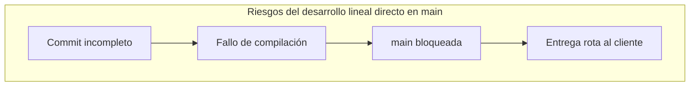

| Riesgo técnico | Qué sucede en el repositorio | Impacto en AzaharTech |
| :--- | :--- | :--- |
| **Código a medias publicado** | Se confirma una clase no terminada en `main`. | El proyecto no compila y la demo con el cliente falla. |
| **Pérdida de reversibilidad** | Se mezclan experimentos fallidos con código estable. | Revertir cambios obliga a deshacer commits manualmente. |
| **Colisiones de equipo** | Dos personas modifican el mismo archivo en `main`. | Conflictos de fusión imprevistos y bloqueos de entrega. |
| **Historial degradado** | Mensajes como *"guardo avance"* conviven con entregas. | Auditoría técnica confusa e inviable. |

##### ¿Qué es realmente una rama en Git?

Una rama **no duplica la carpeta ni los archivos del proyecto**. Es simplemente un **puntero móvil de 41 bytes** que referencia a un commit concreto. Cuando se realiza un nuevo commit en esa rama, el puntero avanza automáticamente. El puntero especial **`HEAD`** señala la rama y el commit en el que se encuentra situado el espacio de trabajo en cada instante.

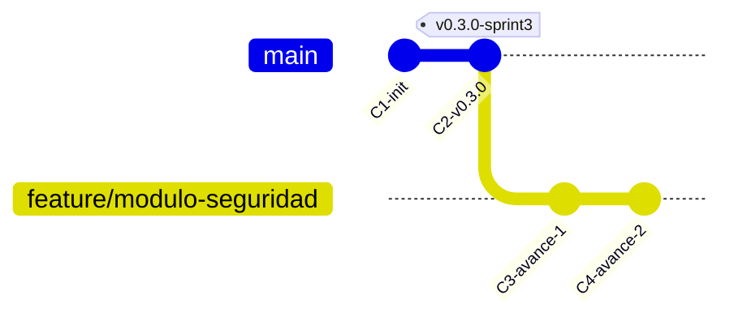

Mientras la rama `feature/modulo-seguridad` avanza acumulando trabajo, la rama `main` permanece inalterada en `C2`, garantizando que el software entregable siga compilando.

##### Nomenclatura corporativa de ramas

AzaharTech exige una convención predecible para identificar de inmediato el propósito de cada rama:

$$\text{Patrón obligatorio:} \quad \mathbf{feature/nombre-tarea}$$

| Regla | Formato correcto | Formato incorrecto | Justificación técnica |
| :--- | :--- | :--- | :--- |
| **Prefijo identificador** | `feature/modulo-seguridad` | `modulo-seguridad` | Distingue ramas temporales de la rama principal. |
| **Minúsculas estrictas** | `feature/clase-credencial` | `feature/ClaseCredencial` | Evita inconsistencias entre sistemas de archivos. |
| **Separación por guiones** | `feature/validar-dni` | `feature/validar dni`, `feature/validación` | Elimina caracteres especiales y espacios conflictivos. |
| **Orientada a la tarea** | `feature/ajuste-aforo` | `feature/lo-de-alba`, `feature/prueba2` | Describe el componente técnico, no a la persona. |

##### Ciclo de vida de una rama de desarrollo

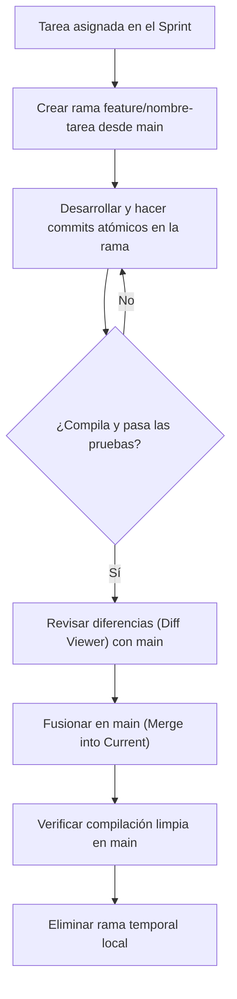

---

#### 3. Actividad activa interactiva: «¿En qué rama estoy?» en la pizarra

Alba y Pau proyectan un historial con dos ramas de desarrollo abiertas de forma simultánea. El grupo debe resolver las cuestiones planteadas antes de continuar:

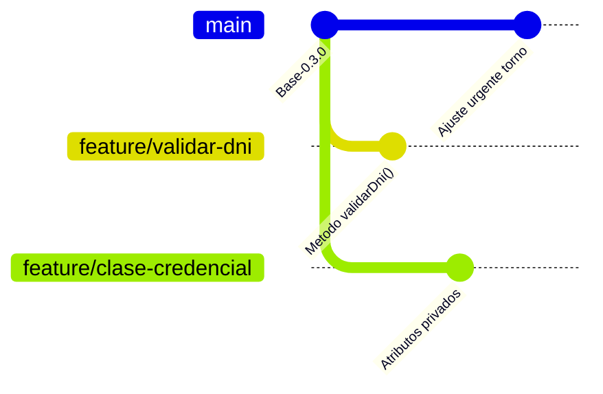

*Dinámica en parejas (10 minutos):*

1. **Lectura del grafo (3 min):**
    * ¿Cuántas ramas existen en el repositorio y cuál es el último commit de cada una?
    * ¿Se ha modificado `main` tras la creación de las ramas de características?
    * Si fusionáramos `feature/validar-dni` en `main`, ¿afectaría a los archivos de `feature/clase-credencial`? ¿Por qué?
2. **Propuesta de nomenclatura (3 min):** Definir el nombre corporativo correcto para tres tareas:

| Tarea técnica planteada | Nombre de rama propuesto |
| :--- | :--- |
| Implementar constructor con validación en `Usuario` | *(a completar por la pareja)* |
| Corregir el umbral de aforo máximo en el vestíbulo | *(a completar por la pareja)* |
| Probar un prototipo experimental de física de rebote | *(a completar por la pareja)* |

3. **Puesta en común (4 min):** Un estudiante voluntario señala en la pizarra en qué punto exacto se bifurcaría el puntero `HEAD` y dónde existiría riesgo de conflicto si dos ramas tocaran el mismo archivo.

---

#### Segunda sesión: dojo de herramientas y katas

> **Dinámica del dojo de entrenamiento:**
>
> * La **Kata 1 es obligatoria** para todo el grupo: enseña a crear ramas, aislar commits y verificar la estabilidad de `main` en IntelliJ IDEA.
> * Las **Katas 2 y 3 son optativas y de ampliación**: permiten profundizar en la inspección visual de diferencias (*Diff Viewer*) y en la integración rápida (*Fast-Forward*).
> 
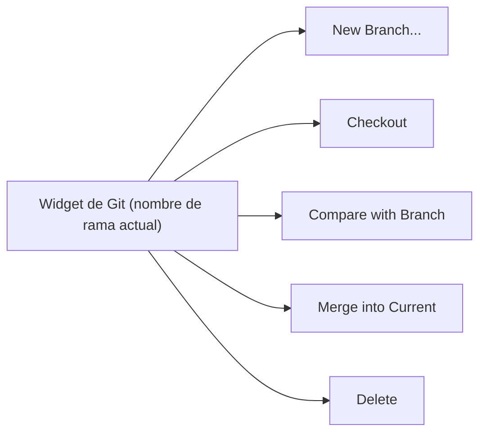

---

##### Kata 1. Obligatoria (cinturón blanco / nivel base). Rama `feature/modulo-seguridad`, commit visual y comprobación de aislamiento

* **Objetivo:** crear una rama personal desde `main` con la herramienta gráfica del IDE, aplicar un cambio aislado y comprobar en **Git Log** que la rama principal no se ha modificado.
* **Misión:**
    1. **Comprobar el punto de partida.** Abre el proyecto en IntelliJ IDEA y verifica en el widget de Git (esquina inferior izquierda) que estás ubicado en `main` y que la pestaña **Commit** (`Alt + 0`) no tiene cambios pendientes de confirmación.
    2. **Crear la rama.** Haz clic en el widget de Git ➔ **New Branch...** ➔ introduce el nombre `feature/modulo-seguridad` ➔ deja marcada la opción **Checkout branch** ➔ pulsa **Create**. Observa cómo el widget pasa a mostrar el nuevo nombre de rama.
    3. **Aplicar un cambio sencillo.** Con la rama activa, abre una clase o archivo de configuración de tu proyecto y añade un comentario Javadoc formal o una constante de configuración (por ejemplo, `public static final int NIVEL_SEGURIDAD = 1;`).
    4. **Commit visual.** Pulsa **`Ctrl + K`**, marca únicamente el archivo modificado, revisa el *Diff* haciendo doble clic sobre él y escribe el mensaje:  
       `feat(seguridad): primer avance del modulo de seguridad`  
       Pulsa el botón **Commit** (sin Push).
    5. **Verificación visual en Git Log.** Abre la pestaña inferior **Git** (`Alt + 9`) ➔ **Log**. Comprueba visualmente que:
        * La etiqueta `feature/modulo-seguridad` (junto al indicador amarillo `HEAD`) apunta al commit recién creado.
        * La etiqueta `main` se mantiene en el commit previo, **sin el cambio realizado**.
    6. **Prueba práctica de aislamiento.** Cambia a `main` desde el widget de Git (**main ➔ Checkout**). Comprueba que el archivo en el editor recupera su estado anterior y la constante desaparece. Vuelve a cambiar a tu rama (**feature/modulo-seguridad ➔ Checkout**) y confirma que el cambio reaparece intacto.

| Elemento verificado en Git Log | Estado esperado tras la Kata 1 |
| :--- | :--- |
| Etiqueta `feature/modulo-seguridad` (`HEAD`) | Apunta al commit nuevo recién realizado. |
| Etiqueta `main` | Permanece en el commit anterior, inalterada. |
| Contenido del archivo al hacer checkout a `main` | Vuelve a su estado original previo al cambio. |

---

##### Kata 2. Optativa (cinturón marrón / nivel avanzado). Inspección con *Compare with Branch* (Diff Viewer)

* **Contexto técnico:** antes de integrar una rama, el desarrollador debe revisar con exactitud qué líneas van a incorporarse a `main`.
* **Misión:**
    1. Estando en `feature/modulo-seguridad`, añade un segundo ajuste menor (por ejemplo, documentar la constante introducida) y realiza un nuevo commit:  
       `docs(seguridad): documentada constante de nivel de acceso`.
    2. Despliega el widget de Git, selecciona la rama `main` y haz clic en **Compare with Current**.
    3. En la ventana **Differences**, haz doble clic sobre el archivo modificado para abrir el visor comparativo (*Diff Viewer*).
    4. Interpreta los colores del visor:

| Color en el Diff Viewer | Significado técnico del cambio |
| :--- | :--- |
| **Verde** | Nuevas líneas agregadas en la rama de trabajo. |
| **Azul** | Líneas preexistentes que han sido modificadas. |
| **Gris** | Líneas eliminadas respecto a la rama comparada. |

---

##### Kata 3. Optativa (cinturón negro / «hacker AzaharTech»). Fusión Fast-Forward visual y borrado seguro

* **Contexto de arquitectura:** cuando una tarea en rama está terminada y validada, se fusiona en `main` y la rama temporal se elimina para mantener la higiene del repositorio.
* **Misión:**
    1. Cambia tu espacio de trabajo a la rama de destino: haz clic en el widget de Git ➔ **main ➔ Checkout**.
    2. Despliega de nuevo el widget de Git, haz clic sobre `feature/modulo-seguridad` y selecciona **Merge into Current**.
    3. Comprueba en **Git Log** que Git realiza un avance rápido (*Fast-Forward*): los punteros `main` y `feature/modulo-seguridad` señalan ahora al mismo commit.
    4. Verifica la compilación limpia del proyecto mediante el menú **Build ➔ Build Project**.
    5. Despliega el widget de Git, haz clic sobre `feature/modulo-seguridad` y selecciona **Delete**.
    6. Confirma que el commit permanece visible en el historial de `main` aunque la etiqueta de la rama haya desaparecido.

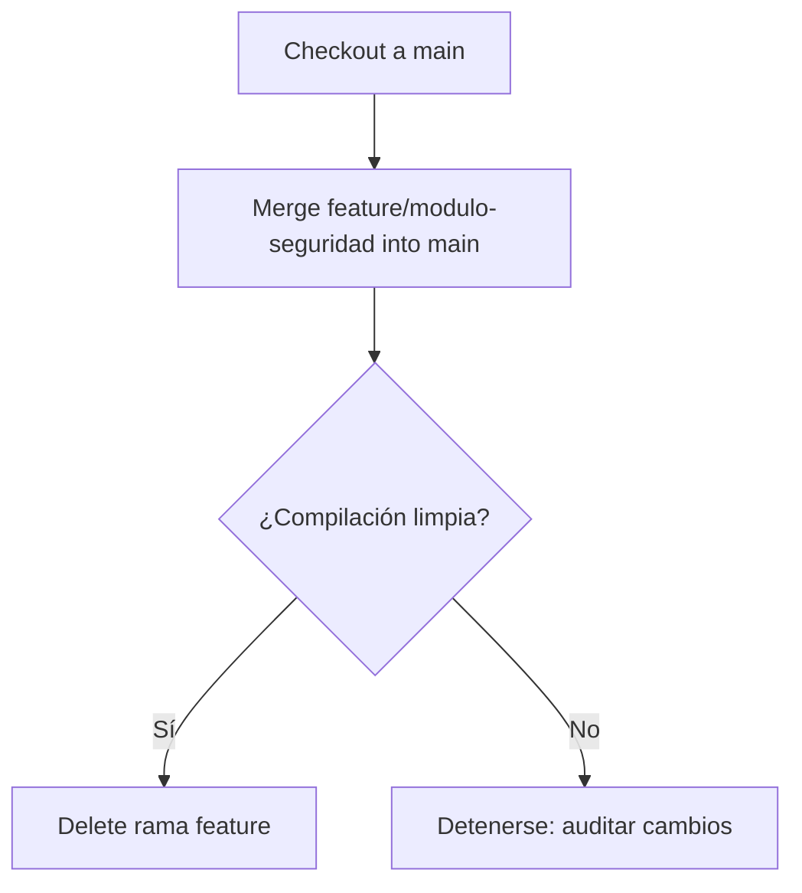

---

#### Entregables de la sesión

Al finalizar la sesión, el repositorio local debe mostrar el trabajo aislado en la rama correspondiente:

| Elemento afectado en el proyecto | Contenido técnico aportado | Operación gráfica en IntelliJ IDEA |
| :--- | :--- | :--- |
| Archivo de código o configuración de tu proyecto | Modificación aislada (comentario Javadoc o constante) realizada en la rama `feature/modulo-seguridad`. | Widget de Git ➔ **New Branch...** ➔ `Ctrl + K` ➔ **Commit**. Mensaje: `feat(seguridad): primer avance del modulo de seguridad`. |
| Estado del historial en Git Log | `feature/modulo-seguridad` contiene el nuevo commit mientras `main` permanece intacta (o fusionada si se completó la Kata 3). | Inspección visual en pestaña **Git ➔ Log** (`Alt + 9`). |

##### Pasos visuales paso a paso en IntelliJ IDEA:

1. **Verificar el contexto de trabajo.** Comprueba en el widget de Git (esquina inferior derecha) que estás en `feature/modulo-seguridad`.
2. **Abrir el panel de confirmación.** Pulsa **`Ctrl + K`** (o pestaña lateral **Commit** / `Alt + 0`).
3. **Auditoría visual previa.** Haz doble clic sobre el archivo modificado para abrir el *Diff Viewer* y revisar los cambios.
4. **Mensaje estructurado.** Marca la casilla del archivo e introduce el mensaje con Conventional Commits:  
   `feat(seguridad): primer avance del modulo de seguridad`
5. **Confirmar commit local.** Pulsa **Commit** (el cambio queda registrado exclusivamente en tu rama personal local).

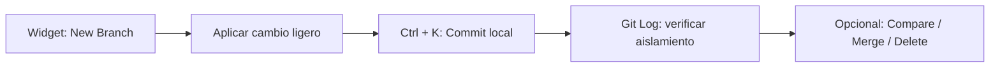

---

### Día 20 - 1 sesión

---

#### Sesión única. Taller práctico: dos ramas concurrentes, primer conflicto de fusión y resolución visual

---

#### 1. Caso guía en AzaharTech

Miércoles 18 de noviembre de 2026. Son las tres de la tarde en las oficinas de **AzaharTech**. Durante la jornada anterior, el equipo dominó la creación de ramas `feature/` y la verificación de aislamiento en `main`.

Al iniciar la sesión, **Laia Claramunt** proyecta una incidencia real registrada en el repositorio del **IES El Caminàs**:

> *«Ayer por la tarde, Alba y Pau trabajaron simultáneamente en dos ramas distintas para ajustar el archivo de configuración de seguridad. Alba cambió la directiva de acceso para indicar "Nivel: Restringido". Pau, en su propia rama, cambió esa misma línea por "Nivel: Solo personal docente". Cuando intentaron fusionar la segunda rama en `main`, Git se detuvo y mostró un aviso de* ***conflicto de fusión***.*
>
> *Un conflicto no es un error de programación ni un fallo del sistema. Aparece cuando dos ramas han modificado exactamente las mismas líneas de un archivo y Git no puede decidir de forma automática cuál debe prevalecer.*
>
> *Lo que distingue a un desarrollador profesional es no entrar en pánico: un conflicto en pausa no rompe nada en el disco. Hoy provocaremos un conflicto de forma controlada en nuestro proyecto y aprenderemos a resolverlo con el* ***asistente visual de tres paneles de IntelliJ IDEA***, *registrando la experiencia en el documento técnico oficial del sprint:* *`ed/docs/control-versiones.md`»*.

---

#### 2. Anatomía de un conflicto de fusión y el asistente visual

##### ¿Cuándo se produce un conflicto?

Git integra ramas automáticamente cuando los cambios afectan a archivos distintos o a líneas separadas del mismo fichero. El conflicto surge exclusivamente ante modificaciones incompatibles sobre la misma zona:

| Escenario de integración | ¿Provoca conflicto? | Motivo técnico |
| :--- | :---: | :--- |
| Rama A edita `Archivo1`, Rama B edita `Archivo2` | **No** | Cambios en ficheros independientes. |
| Rama A y Rama B editan líneas distintas del mismo archivo | **No** | Git combina ambos bloques automáticamente. |
| Rama A y Rama B editan **la misma línea de texto** | **Sí** | Ambigüedad: Git requiere criterio humano. |
| Rama A modifica un archivo y Rama B lo elimina | **Sí** | Incompatibilidad estructural directa. |

##### Representación gráfica del escenario del taller

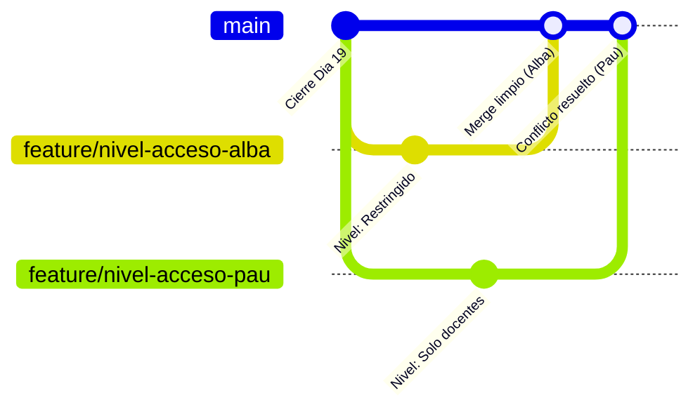

##### Flujo de resolución con el asistente visual

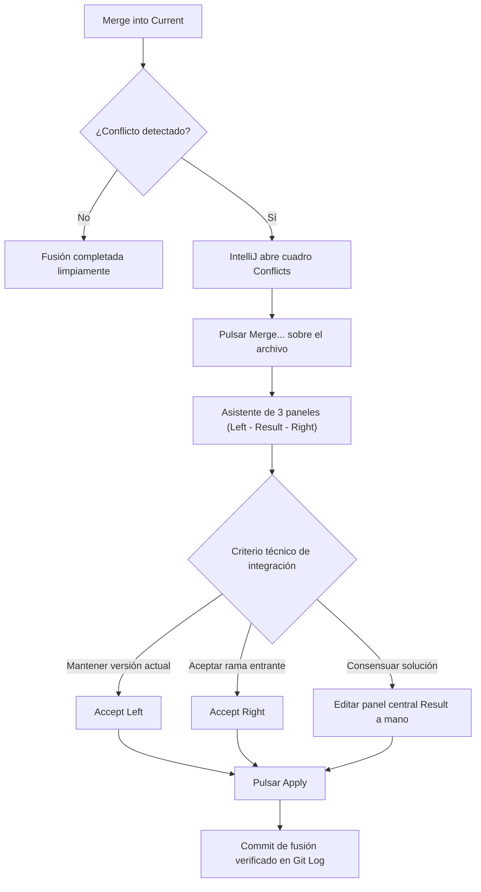

##### El asistente de resolución de tres paneles

Al pulsar el botón **Merge...** en la ventana de conflictos, IntelliJ IDEA abre su herramienta visual especializada:

| Panel visual | Denominación | Qué representa en la integración |
| :--- | :--- | :--- |
| **Columna izquierda** | *Left (Your Version)* | El estado actual de la rama en la que estás situado (`main`). |
| **Columna central** | *Result* | El resultado final editable que se consolidará en el proyecto. |
| **Columna derecha** | *Right (Their Version)* | El cambio que proviene de la rama que estás intentando fusionar. |

Mediante los botones `>>` y `<<` se incorporan cambios parciales al centro. Una vez que el panel central refleja la versión consensuada, se pulsa **Apply** para cerrar el conflicto limpiamente.

---

#### 3. Laboratorio práctico. Provocación y resolución de conflicto en tu proyecto

##### Fase 1. Estado inicial en `main`
Asegúrate de estar en `main` sin cambios pendientes. Abre una clase de configuración o un archivo de tu proyecto y define una variable o comentario base:
`// Nivel de acceso: PENDIENTE_CONFIGURAR`  
Haz commit en `main`: `chore(config): definida directiva base de acceso`.

##### Fase 2. Dos ramas desde el mismo commit
1. Widget de Git ➔ **New Branch...** ➔ `feature/nivel-acceso-alba` ➔ **Create**.
2. Modifica la línea por:  
   `// Nivel de acceso: RESTRINGIDO`
3. Haz commit (`Ctrl + K`): `feat(seguridad): configurado nivel restringido por alba`.
4. Vuelve a `main` desde el widget (**main ➔ Checkout**).
5. Widget de Git ➔ **New Branch...** ➔ `feature/nivel-acceso-pau` ➔ **Create**.
6. Modifica exactamente la misma línea por:  
   `// Nivel de acceso: SOLO_DOCENTES`
7. Haz commit (`Ctrl + K`): `feat(seguridad): configurado nivel docentes por pau`.

##### Fase 3. Primera fusión limpia y segunda fusión con conflicto
1. Haz checkout a **`main`**.
2. Fusiona la rama de Alba: widget de Git ➔ `feature/nivel-acceso-alba` ➔ **Merge into Current**. La fusión se aplica sin problemas (*Fast-Forward*).
3. Intenta fusionar la rama de Pau: widget de Git ➔ `feature/nivel-acceso-pau` ➔ **Merge into Current**.
4. IntelliJ interrumpe el proceso y muestra la ventana emergente **Conflicts**.

##### Fase 4. Resolución visual en el asistente
1. En el diálogo de conflictos, haz clic sobre el archivo afectado y pulsa **Merge...**
2. Se abrirá la vista de tres columnas (*Left*, *Result*, *Right*).
3. En el panel central (*Result*), redacta la solución consensuada por el equipo:  
   `// Nivel de acceso: RESTRINGIDO_PERSONAL_DOCENTE`
4. Pulsa el botón **Apply**. El conflicto queda resuelto sin marcas residuales (`<<<<<<<`, `=======`, `>>>>>>>`).
5. IntelliJ formaliza el *Merge Commit* automáticamente.

##### Fase 5. Limpieza de ramas locales
1. Widget de Git ➔ `feature/nivel-acceso-alba` ➔ **Delete**.
2. Widget de Git ➔ `feature/nivel-acceso-pau` ➔ **Delete**.
3. Abre **Git ➔ Log** (`Alt + 9`) y comprueba el commit de fusión con dos líneas convergentes.

---

#### Entregables de la sesión

Al finalizar la sesión, debes crear el documento técnico oficial del sprint en la ruta estándar del módulo: **`ed/docs/control-versiones.md`**, completando los Apartados 1 y 2:

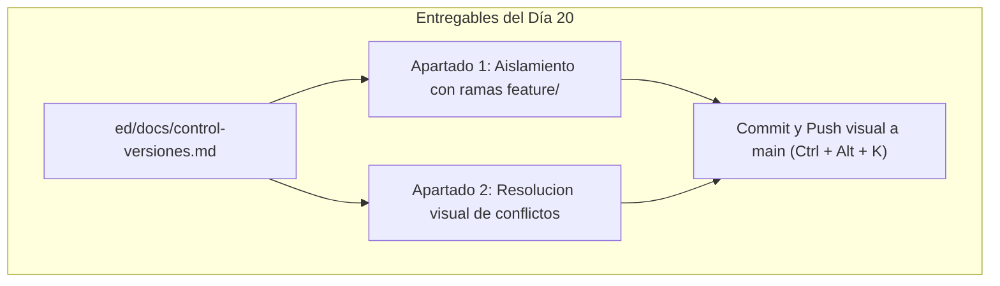

| Archivo en el repositorio | Apartados a cumplimentar | Operación gráfica en IntelliJ IDEA |
| :--- | :--- | :--- |
| **`ed/docs/control-versiones.md`** | **Apartado 1.** Justificación del aislamiento con ramas.<br>**Apartado 2.** Registro del conflicto provocado y resolución visual aplicada. | `Ctrl + K` ➔ redacción de mensaje ➔ desplegar flecha ➔ **Commit and Push...** (`Ctrl + Alt + K`). |

##### Plantilla obligatoria a incorporar en `ed/docs/control-versiones.md`:

```markdown
# Memoria Técnica - Sprint 4: Control de versiones individual y documentación técnica

## Apartado 1: Aislamiento funcional con ramas locales (`feature/`)

### 1. Justificación técnica del principio de aislamiento
El desarrollo directo sobre la rama `main` compromete la estabilidad del proyecto entregable.
El uso de ramas de características (`feature/`) permite aislar cambios en progreso, asegurando
que la rama principal siempre compile limpiamente y esté disponible para el cliente.

### 2. Ciclo de vida y nomenclatura aplicada
- **Patrón corporativo:** `feature/nombre-tarea` (minúsculas y guiones).
- **Ramas utilizadas en la sesión:** `feature/modulo-seguridad`, `feature/nivel-acceso-alba`, `feature/nivel-acceso-pau`.

---

## Apartado 2: Gestión y resolución visual de conflictos de fusión

### 1. Origen del conflicto provocado
- **Archivo afectado:** `[Ruta del archivo modificado, ej. src/main/java/.../Config.java]`
- **Rama A (Alba):** Modificó la línea con el valor `RESTRINGIDO`.
- **Rama B (Pau):** Modificó exactamente la misma línea con el valor `SOLO_DOCENTES`.

### 2. Proceso de resolución con el asistente visual
- **Herramienta empleada:** Asistente de fusión de 3 paneles (*Merge Tool*) de IntelliJ IDEA.
- **Decisión técnica adoptada:** Consensuar la integración combinando ambos requisitos.
- **Resultado consolidado en el panel Result:** `RESTRINGIDO_PERSONAL_DOCENTE`.
- **Verificación posterior:** Fusión cerrada sin marcas textuales de conflicto y compilación verificada.

### 3. Diagrama del historial consolidado (Mermaid)

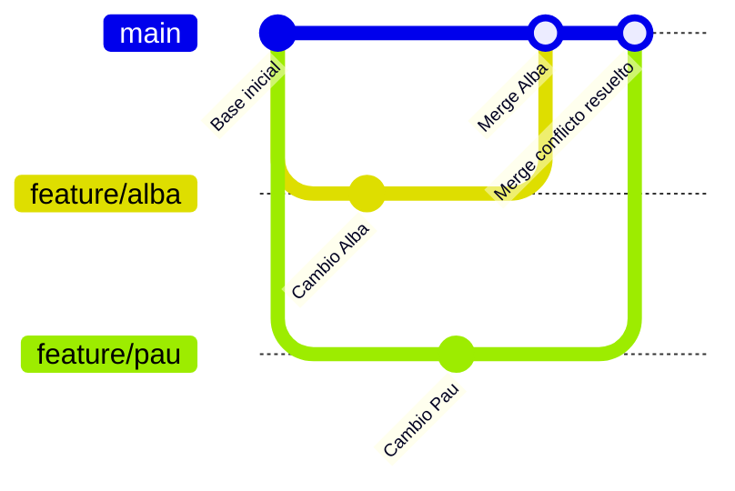

##### Pasos visuales para el commit y push en IntelliJ IDEA:

1. Verifica en el widget de Git que estás situado en **`main`**.
2. Pulsa **`Ctrl + K`** (o pestaña lateral **Commit**).
3. Marca la casilla del nuevo archivo `ed/docs/control-versiones.md`.
4. Escribe el mensaje formal estructurado:  
   `docs(git): creado control-versiones.md con apartados 1 y 2 de ramas y conflictos`
5. Despliega la flecha del botón azul y selecciona **Commit and Push...** (`Ctrl + Alt + K`).
6. En el cuadro de diálogo *Push Commits*, confirma que el destino remoto es `origin/main` y pulsa el botón azul **Push**.

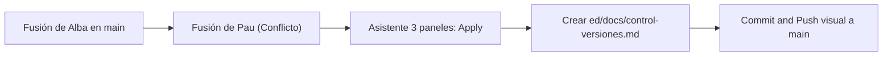

